# DevOpsAC1

## Participação individual — Gabriel

### User Story escolhida

**Como** administrador de uma plataforma de ensino gamificada,
**quero** criar uma missão de "subir de nível" para o aluno,
**para** manter o engajamento através de gamificação.

### BDD 1 — Gabriel

**Cenário:** aluno com média igual ou superior a 7,0 recebe cursos extras.

* **Dado** um aluno que concluiu um curso;
* **E** sua média final foi igual ou superior a 7,0;
* **Quando** o sistema processa o encerramento do curso;
* **Então** ele deve ter direito a escolher mais três cursos.


### Implementação com TDD

A lógica de concessão de acesso ao curso extra foi extraída para um método

Após a refatoração, os testes devem continuar sendo executados para garantir que o comportamento anteriormente validado permaneça funcionando.
Antes de qualquer implementação, o teste foi executado e falhou conforme esperado, comprovando que ele realmente testa a regra de negócio e não um "green falso".

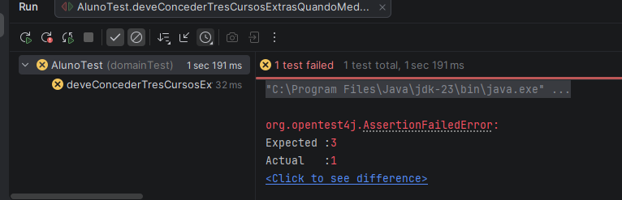

#### 🟢 GREEN

Com a implementação de `Aluno.encerrarCurso()` feita, o teste principal passou. Nesta etapa a cobertura de código ainda não estava em 100% — o branch referente ao cenário de média inferior a 7,0 seria coberto posteriormente pelo BDD 2 (Leonardo), como parte do trabalho dividido entre a equipe.

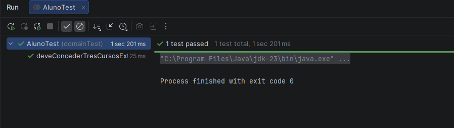

#### 🔵 BLUE

Após o GREEN, a classe `Aluno` foi revisada (ajustes de formatação e nomenclatura) e testes complementares foram adicionados para fechar os branches não cobertos. Com isso, a suíte de testes atingiu 100% de cobertura, sem necessidade de refatoração adicional na lógica de negócio.

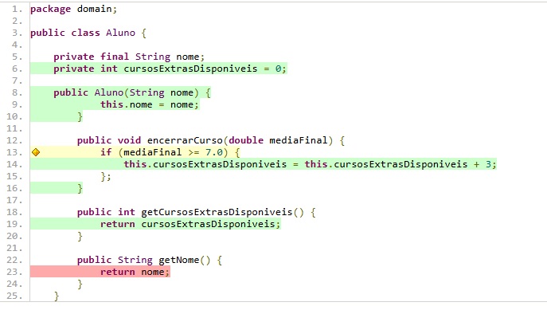
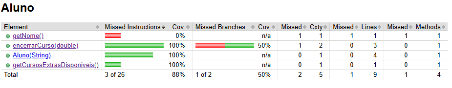

### Arquivos implementados

* `AC1/src/main/java/domain/Aluno.java`
* `AC1/src/test/java/domainTest/AlunoTest.java`

### Regra implementada

* Aluno com curso concluído e média igual ou superior a 7,0 recebe três cursos extras.
* Aluno com média inferior a 7,0 não recebe cursos extras (branch complementado pelo BDD 2 — Leonardo).


## Participação individual — Leonardo

### User Story escolhida

**Como** administrador da plataforma,
**quero** conceder automaticamente o direito a mais três cursos para alunos que concluírem um curso com média superior a 7,0,
**para** incentivar a retenção e o bom desempenho acadêmico na plataforma.

### BDD 2 — Leonardo

**Cenário:** aluno com média inferior a 7,0 não recebe cursos extras.

* **Dado** um aluno que concluiu um curso;
* **E** sua média final foi inferior a 7,0;
* **Quando** o sistema processa o encerramento do curso;
* **Então** ele não deve ter direito a escolher mais três cursos.

O cenário também está versionado em:

`AC1/src/test/resources/features/concessao-cursos-extras.feature`

### Implementação com TDD

A implementação foi desenvolvida seguindo o ciclo RED, GREEN e BLUE.

#### RED

O teste foi criado antes da implementação correta da regra. A primeira versão concedia três cursos independentemente da média, fazendo o teste falhar com o resultado esperado `false` e o resultado obtido `true`.

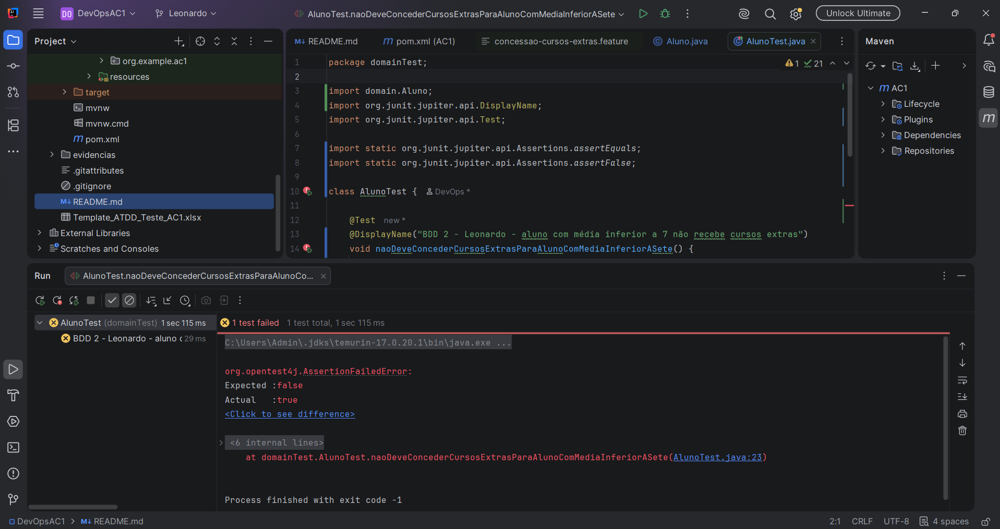

#### GREEN

A regra foi implementada para conceder três cursos somente quando o aluno concluiu o curso e obteve média superior a 7,0. Com a correção, o teste do BDD 2 passou.

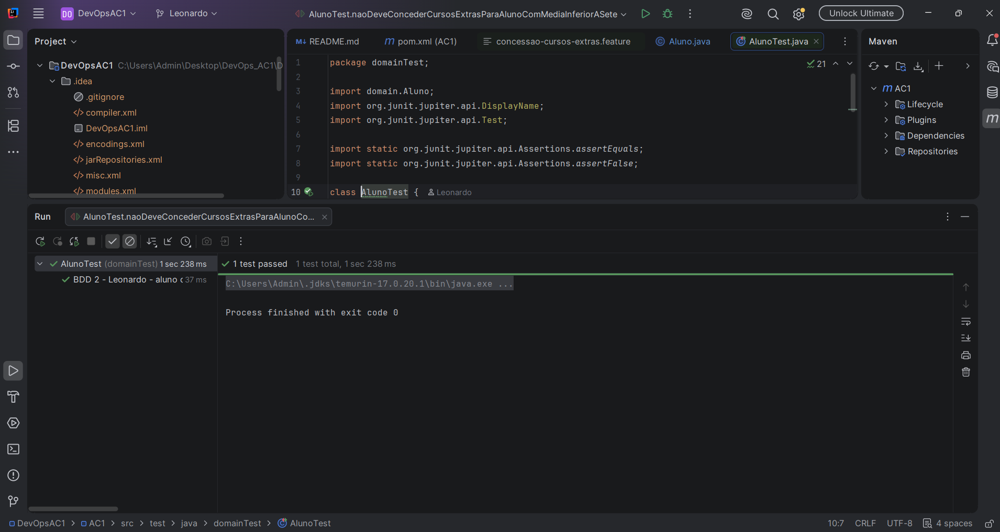

#### BLUE

O código foi refatorado com constantes para a média mínima e a quantidade de cursos extras, além da extração do critério de elegibilidade para um método próprio.

Também foram adicionados testes técnicos complementares para cobrir todos os caminhos da regra de negócio.

O relatório do JaCoCo apresentou:

* 100% das instruções;
* 100% dos branches;
* 100% das linhas;
* 100% dos métodos;
* 100% das classes.

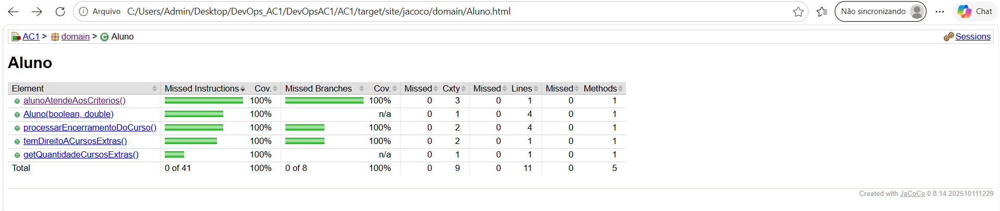

### Arquivos implementados

* `AC1/src/main/java/domain/Aluno.java`
* `AC1/src/test/java/domainTest/AlunoTest.java`

### Regra implementada

* Aluno com saldo de cursos extras pode realizar matrículas enquanto houver saldo disponível.
* Ao efetuar uma matrícula em um curso extra, o aluno recebe acesso ao curso.
* Após utilizar os três cursos extras liberados por desempenho, o saldo de cursos extras é zerado.
* `AC1/src/test/resources/features/concessao-cursos-extras.feature`
* `evidencias/Leonardo/BDD2-RED.png`
* `evidencias/Leonardo/BDD2-GREEN.png`
* `evidencias/Leonardo/BDD2-BLUE-JACOCO-100.png`

### Regra implementada

* Aluno com curso concluído e média superior a 7,0 recebe três cursos extras.
* Aluno com média inferior a 7,0 não recebe cursos extras.
* Aluno que ainda não concluiu o curso não recebe cursos extras.

## Participação individual — Ariane

### BDD 3 — Ariane

**Cenário:** aluno com média final igual a 7,0 tem direito à recuperação.

* **Dado** um aluno que concluiu um curso;
* **E** sua média final foi igual a 7,0;
* **Quando** o sistema processa o encerramento do curso;
* **Então** ele deve ter direito a uma recuperação.

### Implementação com TDD

A implementação foi desenvolvida seguindo o ciclo RED, GREEN e BLUE.

🔴 RED
O teste foi criado para validar que, ao encerrar um curso com média final igual a 7,0, o aluno recebe a mensagem informando seu direito à recuperação.

Nesta etapa, a implementação retornava propositalmente uma mensagem incorreta. O teste falhou conforme esperado, apresentando:

* **Esperado:** `Aluno tem direito a uma recuperação`
* **Obtido:** `Mensagem errada`

Essa falha comprova que o teste está validando corretamente a regra de negócio.

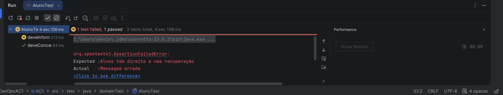

#### 🟢 GREEN

Após corrigir a mensagem de recuperação, os dois testes passaram.

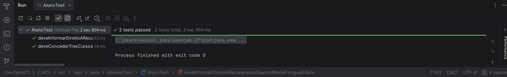

#### 🔵 BLUE

Após o GREEN, a mensagem de recuperação foi extraída para uma
constante, mantendo o comportamento da regra de negócio.

Foram adicionados testes complementares para verificar o nome
do aluno e o cenário de média inferior a 7,0.

O relatório do JaCoCo confirmou 100% de cobertura de instruções,
branches, linhas e métodos da classe Aluno.

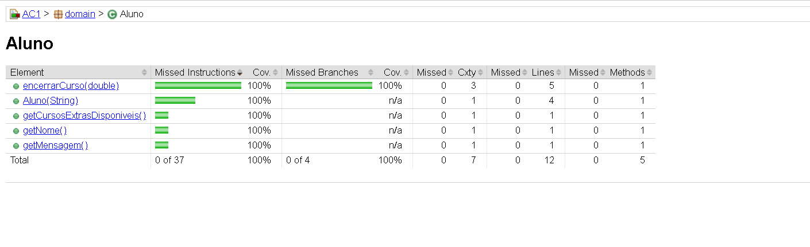

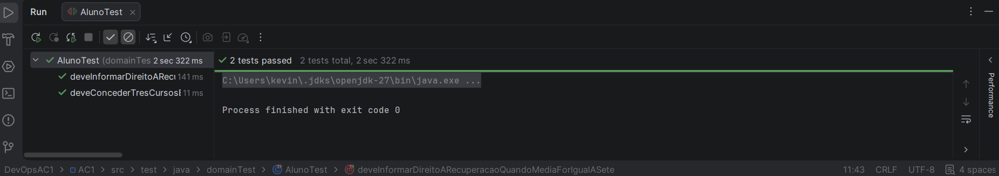


## Participação individual — Luiz

### BDD 4 — Luiz


#### 🔴 RED

O teste foi criado para validar que, após a matrícula no terceiro curso adicional, o aluno deve receber acesso ao curso.

Nesta etapa, o teste foi executado antes da implementação da funcionalidade de acesso ao curso extra. O teste falhou conforme esperado, pois o método `temAcessoAoCursoExtra()` ainda não existia na classe `Aluno`.

O erro apresentado foi:


* **Esperado:** verificar se o aluno possui acesso ao curso extra;
* **Obtido:** erro de compilação, pois o método `temAcessoAoCursoExtra()` não estava implementado.

Essa falha comprova que o teste foi criado antes da implementação da regra, caracterizando a etapa RED.

#### 🟢 GREEN

Após a falha do teste, foi implementada a funcionalidade mínima necessária na classe `Aluno`.

Foi adicionada a propriedade responsável por controlar o acesso ao curso extra:

```java
private boolean acessoAoCursoExtra;
```

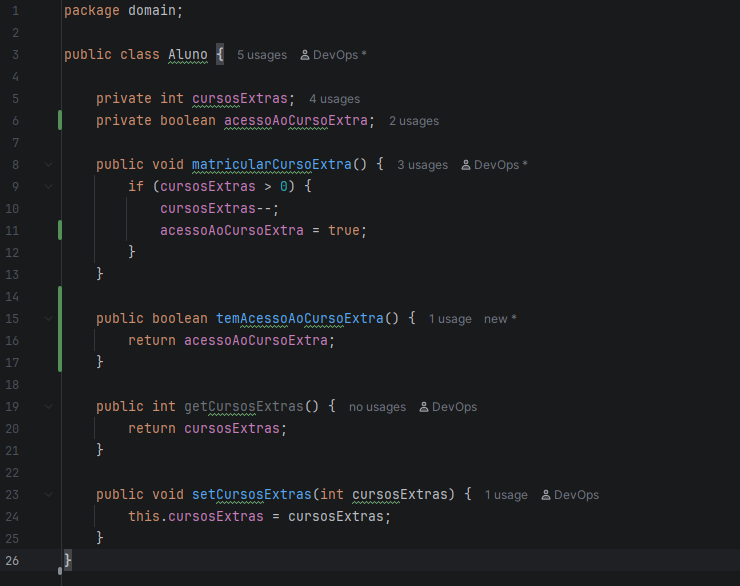

Também foi implementado o método `temAcessoAoCursoExtra()` e ajustado o método `matricularCursoExtra()` para conceder o acesso ao curso quando houver saldo disponível.

Após a implementação, os testes foram executados novamente e apresentaram:


Dessa forma, o teste passou conforme esperado, concluindo a etapa GREEN.

#### 🔵 BLUE

Após o GREEN, a implementação foi revisada buscando melhorar a organização do código sem alterar o comportamento validado pelos testes.

A lógica de concessão de acesso ao curso extra foi extraída para um método específico, `concederAcessoAoCursoExtra()`, mantendo a responsabilidade da matrícula separada da responsabilidade de conceder o acesso.

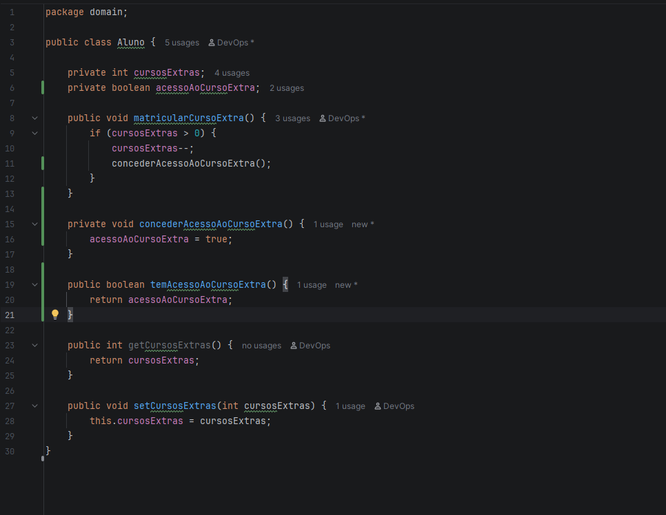

Após a refatoração, os testes devem continuar sendo executados para garantir que o comportamento anteriormente validado permaneça funcionando.
Antes de qualquer implementação, o teste foi executado e falhou conforme esperado, comprovando que ele realmente testa a regra de negócio e não um "green falso".

## Docker e Banco de Dados

A aplicação foi configurada para execução com Docker, utilizando PostgreSQL em container e Spring Boot em outro container.

### Estrutura utilizada

- Spring Boot
- PostgreSQL 16
- Docker
- Docker Compose
- Profile H2 para desenvolvimento/testes
- Profile PostgreSQL para execução via Docker

### Execução

Para subir os containers:

```bash
docker compose up -d --build
```
Para verificar os containers em execução:

```bash
docker ps
```

A aplicação fica disponível em:

http://localhost:8081

O PostgreSQL fica disponível na porta:

5432

---
## Mudança de arquitetura: de Camadas para Monólito Modular

> **Architecture Lab B1 — Desafio 1: Drivers e evolução do Core.**
> A mudança é **estrutural** (pacotes, visibilidade e regras de dependência): nenhuma regra de negócio, endpoint ou contrato HTTP é alterado. O Core continua com um único deploy, um único Spring Boot e o mesmo banco relacional.

### 1. Contexto

O MVP de gamificação evolui de ~1.000 usuários para até **100.000 usuários**. Ranking, Cursos, Conquistas e Recompensas continuam no Core, mas o **Ranking tende a crescer mais** que as demais capacidades.

A pergunta que guia a decisão:

> Há evidência suficiente para introduzir distribuição e deploy independente agora, ou uma modularização interna resolve o problema com menor custo operacional?

#### O que existe hoje no código da AC1

O repositório implementa a capacidade de **cursos extras por desempenho** (regra de recompensa do aluno):

| Regra | Onde está |
|---|---|
| Média **> 7,0** e curso concluído → 3 cursos extras | `domain.Aluno#processarEncerramentoDoCurso` |
| Média **= 7,0** e curso concluído → direito a recuperação | `domain.Aluno` |
| Média **< 7,0** → sem direito | `domain.Aluno` |
| Resgate de curso extra consome o saldo | `AlunoEntity#resgatarCursoExtra` / `AlunoService#resgatar` |

Ranking, Cursos e Conquistas **ainda não possuem código** neste repositório. Eles aparecem na estrutura-alvo como módulos previstos (esqueleto), para que a fronteira exista antes de a funcionalidade chegar.

---

### 2. Rastreabilidade da decisão

Regra de leitura: **RF/RNF → ASR + RPC → alternativas → ADR → C4 → evidência.**

| Elemento | Resumo |
|---|---|
| **RF** | RF01 Ranking · RF02 Conquistas/gamificação (recompensas por desempenho, como os cursos extras da AC1) |
| **RNF analisados** | Manutenibilidade, escalabilidade, complexidade operacional, desempenho, testabilidade |
| **ASR selecionados** | **Manutenibilidade**, **Escalabilidade**, **Complexidade operacional** |
| **Não são ASR agora** | Desempenho (sem medição de gargalo) e Testabilidade (melhora como efeito, mas não decide a macro-estrutura) |
| **RPC** | Java/Spring Boot · equipe de 4 devs · banco relacional existente · legado da AC1 (evolução incremental, sem reescrita) |
| **Alternativas** | A) Monólito em Camadas · B) **Monólito Modular** · C) Serviços independentes |
| **Decisão** | **B — Monólito Modular** (ADR-001) |

#### RPC e seus trade-offs

| RPC | O que ganhamos | O que aceitamos |
|---|---|---|
| Spring Boot (legado AC1) | Reuso total, sem reescrita | Fronteiras dependem de disciplina/ArchUnit, não do compilador |
| Equipe de 6 devs | Operação simples | Sem escala/deploy independente por módulo |
| Banco relacional único | Transações simples, sem nova tecnologia | Banco compartilhado entre módulos |
| Evolução incremental | Risco baixo, passos reversíveis | Convivência temporária entre estruturas |

#### Por que não ficar em camadas (A)?

Em camadas, qualquer classe de `service/` enxerga qualquer outra de `repository/` ou `entity/`. Conforme Ranking, Cursos, Conquistas e Recompensas crescem, o acoplamento entre capacidades aumenta sem que nada no código impeça. É funcional hoje, mas pouco preparada para a evolução prevista.

#### Por que não microsserviços (C)?

Seria prematuro: rede, contratos, observabilidade e tolerância a falhas distribuídas cairiam sobre 6 pessoas, e **não há medição** de latência/throughput provando gargalo. Hoje a distribuição custa mais do que resolve.

---

### 3. ADR-001 — Evoluir o Core de Monólito em Camadas para Monólito Modular

| Campo | Registro |
|---|---|
| **Status** | Aceito |
| **Contexto** | Crescimento até 100 mil usuários; Ranking cresce diferente; demais capacidades seguem evoluindo. |
| **ASRs** | Manutenibilidade; Escalabilidade; Complexidade operacional. |
| **RPCs** | Spring Boot; 6 desenvolvedores; banco relacional; legado AC1. |
| **Alternativas** | A) Monólito em Camadas; B) Monólito Modular; C) Decomposição seletiva em serviços. |
| **Decisão** | Adotar Monólito Modular e preservar uma fronteira clara para o Ranking (candidato a extração futura). |
| **Consequências positivas** | Separação de responsabilidades; menor acoplamento; evolução incremental; custo operacional bem menor que microsserviços. |
| **Trade-offs** | Deploy ainda conjunto; processo e banco compartilhados; Ranking ainda sem escala independente. |
| **Gatilho de revisão** | Reavaliar extração do Ranking quando métricas mostrarem gargalo, necessidade de escala própria ou de deploy independente. |

---

### 4. C4 — Contexto, Container, Componente e Código

#### 4.1 Nível 1 — Contexto

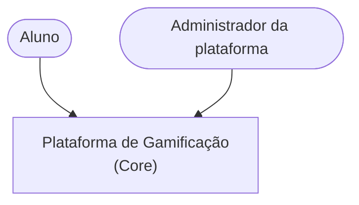

#### 4.2 Nível 2 — Container

O Core continua sendo **um único container** (o `index.html` é servido pelo próprio Spring Boot, em `static/`). O que muda é a organização interna.

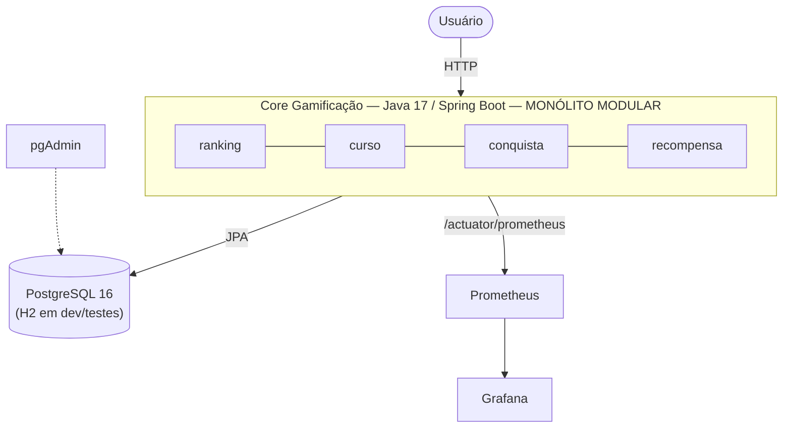

> Prometheus e Grafana fazem parte da 2ª parte (observabilidade) e ainda precisam ser adicionados ao `docker-compose.yml`.

#### 4.3 Nível 3 — Componente (dentro do Core)

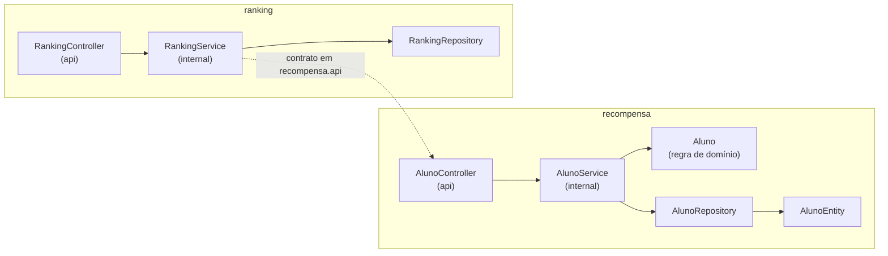

A seta tracejada é a **única** forma permitida de o Ranking obter dados de Recompensas: por contrato na `api`, nunca por `internal`.

#### 4.4 Nível 4 — Código
Exemplo do módulo `recompensa`, com trechos reais da AC1 já no estado-alvo (`api` chama `internal`).

**`recompensa/api/AlunoController.java`** — porta de entrada HTTP:

```java
package org.example.ac1.recompensa.api;

@RestController
@RequestMapping("/api/alunos")
public class AlunoController {

    private final AlunoService service;

    public AlunoController(AlunoService service) {
        this.service = service;
    }

    @PostMapping("/processar-encerramento")
    @ResponseStatus(HttpStatus.CREATED)
    public AlunoResponse cadastrar(@RequestBody AlunoRequest request) {
        return service.cadastrar(request);
    }
}
```

**`recompensa/internal/Aluno.java`** — regra de negócio (média acima de 7,0 dá 3 cursos extras):

```java
package org.example.ac1.recompensa.internal;

public class Aluno {

    private static final double MEDIA_MINIMA_PARA_CURSOS_EXTRAS = 7.0;
    private static final int QUANTIDADE_DE_CURSOS_EXTRAS = 3;

    public void processarEncerramentoDoCurso() {
        if (cursoConcluido && mediaFinal > MEDIA_MINIMA_PARA_CURSOS_EXTRAS) {
            this.quantidadeCursosExtras = QUANTIDADE_DE_CURSOS_EXTRAS;
        } else {
            this.quantidadeCursosExtras = 0;
        }
    }
}
```

O controller só enxerga o serviço do próprio módulo. Os demais módulos não importam nada de `recompensa.internal`.

---

### 4.5 Pipeline atual da AC1 (Jenkinsfile)

| Etapa | O que faz |
|---|---|
| 0 Preflight | Verifica Java, Docker, Compose e daemon |
| 1 Checkout | Baixa o código |
| 2 CI | `./mvnw clean test` + relatório JaCoCo |
| 3 Qualidade | PMD |
| 4 Package | Gera o `.jar` |
| 5 Build | `docker compose build app` |
| 6 Registry | Push no Docker Hub (opcional) |
| 7–8 Deploy HOMOL | `docker compose up` + health check em `/actuator/health` |
| 9 E2E | Cypress (opcional) |
| 10 Observabilidade | Hoje só imprime URLs; será substituída por Prometheus/Grafana |

A modularização **não altera nenhuma etapa**: continua um artefato, uma imagem e um deploy.

### 4.6 Modular × Camadas

| Critério | Camadas (A) | Modular (B) |
|---|---|---|
| Organização | Por tipo técnico | Por capacidade de negócio |
| Onde mudar uma regra | Vários pacotes | Um módulo |
| Fronteiras | Convenção | Explícitas (`api` / `internal`) |
| Acoplamento entre capacidades | Livre, cresce com o tempo | Só via contrato |
| Testes | Espalhados | Por módulo |
| Extrair o Ranking depois | Muita reorganização | Fronteira já existe |
| Custo operacional | Baixo | Baixo (mesmo deploy) |
| Esforço inicial | Nenhum | Moderado (mover pacotes, regras) |

---

### 5. Antes × Depois

#### 5.1 Antes — organizado por camada técnica (estado atual do repositório)

```text
AC1/src/main/java/
├── domain/
│   └── Aluno.java                  ← fora do pacote base da aplicação
└── org/example/ac1/
    ├── Ac1Application.java
    ├── controller/AlunoController.java
    ├── dto/AlunoRequest.java
    ├── dto/AlunoResponse.java      ← conhece AlunoEntity e domain.Aluno
    ├── service/AlunoService.java
    ├── repository/AlunoRepository.java
    └── entity/AlunoEntity.java
```

Pontos de atenção identificados no código atual:

1. **Organização por camada:** para entender "recompensa por desempenho" é preciso navegar por 5 pacotes.
2. **Tudo é `public`:** nada impede que outro futuro módulo (ex.: Ranking) use `AlunoRepository` ou `AlunoEntity` diretamente.
3. **`AlunoResponse.de(AlunoEntity)`:** o DTO (camada de API) depende da entidade JPA e do domínio, e ainda **executa regra de negócio** (`processarEncerramentoDoCurso`) ao montar a resposta. A API conhece o interior.
4. **`domain.Aluno` fora de `org.example.ac1`:** o domínio fica solto, sem pertencer a nenhuma capacidade.

#### 5.2 Depois — organizado por capacidade de negócio (estado-alvo)

```text
AC1/src/main/java/org/example/ac1/
├── Ac1Application.java
│
├── recompensa/                         ← capacidade que hoje contém a regra da AC1
│   ├── api/                            ← ÚNICA superfície pública do módulo
│   │   ├── AlunoController.java
│   │   ├── AlunoRequest.java
│   │   └── AlunoResponse.java
│   └── internal/                       ← invisível para os demais módulos
│       ├── AlunoService.java
│       ├── AlunoRepository.java
│       ├── AlunoEntity.java
│       └── Aluno.java                  ← antigo domain.Aluno
│
├── ranking/      { api/  internal/ }   ← esqueleto (candidato a extração futura)
├── curso/        { api/  internal/ }   ← esqueleto
└── conquista/    { api/  internal/ }   ← esqueleto
```

#### 5.3 Mapa de movimentação

| Classe | De | Para |
|---|---|---|
| `AlunoController` | `ac1.controller` | `ac1.recompensa.api` |
| `AlunoRequest` | `ac1.dto` | `ac1.recompensa.api` |
| `AlunoResponse` | `ac1.dto` | `ac1.recompensa.api` |
| `AlunoService` | `ac1.service` | `ac1.recompensa.internal` |
| `AlunoRepository` | `ac1.repository` | `ac1.recompensa.internal` |
| `AlunoEntity` | `ac1.entity` | `ac1.recompensa.internal` |
| `Aluno` | `domain` | `ac1.recompensa.internal` |

> **Nome do módulo:** `recompensa` é uma sugestão por ser a capacidade que a AC1 implementa. Se a equipe preferir `conquista` ou `aluno`, a lógica da refatoração é a mesma.

---

### 6. Regras de dependência

```text
        ┌────────────────────────────────────────────┐
        │  Módulo X                                  │
        │  ┌───────┐   usa    ┌──────────────────┐   │
 HTTP ─▶│  │  api  │ ───────▶ │     internal     │   │
        │  └───────┘          └──────────────────┘   │
        └───────▲────────────────────────────────────┘
                │  único ponto de contato permitido
        ┌───────┴────────┐
        │  Módulo Y      │   (nunca acessa X.internal)
        └────────────────┘
```

1. **`internal` é privado ao módulo.** Nenhuma classe de outro módulo pode importar `*.internal.*`.
2. **Módulos conversam só via `api`** (DTOs, interfaces/serviços de fachada expostos pelo módulo).
3. **`internal` nunca depende de `api` de outro módulo por atalho**: se Ranking precisar de dados de Recompensas, isso passa por um contrato explícito em `recompensa.api`.
4. **Sem ciclos** entre módulos.
5. **Um banco, um deploy:** a modularização não separa schema nem processo (ver trade-offs do ADR).

---

### 7. Como fazer a refatoração (passo a passo incremental)

Cada passo termina com `./mvnw clean test` **verde**. Se quebrar, o passo anterior é o ponto de retorno.

1. **Rodar a suíte antes de tocar em nada** e guardar o resultado e o relatório JaCoCo como linha de base.
2. **Criar o pacote `recompensa/{api,internal}`** e mover as classes conforme o mapa da seção 5.3 (use *Refactor → Move* da IDE para atualizar imports automaticamente).
3. **Trazer `domain.Aluno` para dentro do módulo** (`recompensa.internal`). Ajustar `AlunoTest` (hoje em `domainTest`) para o novo pacote.
4. **Remover o acoplamento da API com o interior:**
   - Hoje: `AlunoResponse.de(AlunoEntity)` monta a resposta e executa `processarEncerramentoDoCurso()`.
   - Alvo: a **montagem da resposta passa para `internal`** (ex.: método no `AlunoService`), e `AlunoResponse` vira um `record` simples, sem conhecer entidade nem domínio.
5. **Reduzir a visibilidade em `internal`:** `AlunoService`, `AlunoRepository`, `AlunoEntity` e `Aluno` passam a *package-private* onde o Spring permitir. Só o que o `api` precisa continua acessível.
6. **Criar os esqueletos** `ranking/`, `curso/` e `conquista/` com `api/` e `internal/` (por exemplo, um `package-info.java` descrevendo a responsabilidade). Assim a fronteira existe antes do código.
7. **Proteger a regra com teste de arquitetura** (recomendado): um teste [ArchUnit](https://www.archunit.org/) que falha se alguma classe fora do módulo acessar `..internal..`. Sem isso, a fronteira depende apenas de disciplina.
8. **Atualizar este README, o ADR e o C4**, e versionar a evidência antes/depois.

> **Mudança nos testes:** `AlunoControllerIntegrationTest` e `AlunoServiceIntegrationTest` usam `AlunoRepository`/`AlunoService` diretamente. Ao tornar `internal` privado, esses testes devem ficar **no mesmo pacote do módulo** (`recompensa.internal`) ou passar a exercitar o módulo apenas pela `api`/HTTP.

---

### 8. Evidência: o comportamento foi preservado?

A evidência **não é** "a aplicação continua subindo". O que comparar:

| Evidência | Antes | Depois (esperado) |
|---|---|---|
| **Organização** | Por camada técnica | Por capacidade de negócio |
| **Dependências** | Qualquer classe acessa qualquer outra | Dependências entre módulos explícitas e só via `api` |
| **Testes** | Mudança espalhada em vários pacotes | Testes concentrados por módulo |
| **Evolução futura** | Extrair uma capacidade exige reorganizar muito | Ranking com fronteira pronta para extração, se necessário |
| **Comportamento** | Suíte da AC1 verde, cobertura JaCoCo 100% na regra de domínio | **Mesma suíte verde, mesmos resultados** |

#### Comandos de verificação

```bash
cd AC1

# Suíte completa (JUnit + JaCoCo) — rodar ANTES e DEPOIS da refatoração
./mvnw -B clean test

# Relatório de cobertura
# AC1/target/site/jacoco/index.html

# Subir a aplicação para validar os endpoints (perfil H2 por padrão)
./mvnw spring-boot:run
# Swagger: http://localhost:8080/swagger-ui.html
```

Para execução com PostgreSQL via Docker, na raiz do repositório:

```bash
docker compose up -d --build
# API: http://localhost:8081  ·  Health: http://localhost:8081/actuator/health
```

#### Contrato HTTP que **não pode mudar**

| Método | Rota |
|---|---|
| `GET` | `/api/alunos` |
| `POST` | `/api/alunos/processar-encerramento` |
| `POST` | `/api/alunos/{id}/concluir-outro-curso` |
| `POST` | `/api/alunos/{id}/resgatar-curso-extra` |

Os testes de integração (`AlunoControllerIntegrationTest`, `AlunoServiceIntegrationTest`) e os testes de domínio (`AlunoTest`, `AlunoEntityTest`) cobrem esse comportamento e servem como rede de segurança da refatoração.

---

### 9. Impacto no pipeline (Jenkins)

Nenhuma etapa do `Jenkinsfile` precisa mudar: continua um único artefato (`mvn package`), uma única imagem Docker e um único deploy. Esse é exatamente o ganho de operação frente a microsserviços.

---

### 10. Conclusão

**O que se pretende comprovar:** o Core pode ser reorganizado por capacidade de negócio **sem comunicação distribuída** e **sem alterar o comportamento funcional**, reduzindo o acoplamento estrutural e mantendo a operação compatível com uma equipe de 6 pessoas.

**O que NÃO foi decidido:** extrair o Ranking para um serviço independente. O cenário informa crescimento, mas não traz evidência de gargalo nem necessidade comprovada de deploy independente.

**O que ainda precisa ser medido antes de extrair um serviço:**

- latência (p95/p99) das operações de Ranking sob carga;
- throughput e uso de CPU/memória por capacidade;
- frequência de deploy do Ranking comparada às demais capacidades;
- contenção no banco compartilhado.

Quando essas métricas justificarem o custo da distribuição, o **ADR-001 deve ser revisitado** e o módulo `ranking` será o primeiro candidato, justamente por já ter fronteira definida.

---

### 11. Checklist de entrega (evidências no Git)

- [ ] README arquitetural com RF → RNF → ASR → RPC → alternativas → decisão (este documento)
- [ ] ADR-001 com decisão e trade-offs
- [ ] C4 Container atualizado
- [ ] Código da modularização (módulo `recompensa`)
- [ ] Evidência antes/depois da estrutura e das dependências
- [ ] Testes executados após a refatoração (`./mvnw clean test` verde + JaCoCo)
- [ ] Conclusão: o que foi comprovado e o que ainda precisa ser medido

---

### 12. Próximos passos — Implementação

Fluxo pedido: **AC1 → Ranking → Jenkinsfile → 100% de cobertura → Observabilidade (Grafana + Prometheus).**

| # | Item | Situação no repositório | O que falta |
|---|---|---|---|
| 1 | Ranking | Não existe código | Criar o módulo `ranking/{api,internal}` com a regra de ordenação dos alunos |
| 2 | Jenkinsfile | Existe, 10 etapas | Ajustar às mudanças (testes do Ranking, etapa de observabilidade real). Há referências a `ParticipanteRepositoryTest`/Testcontainers que não existem no repo |
| 3 | 100% de cobertura | JaCoCo configurado; 100% só na regra de domínio (`Aluno`) | Cobrir o Ranking e, se exigido, impor mínimo no build com a regra `check` do JaCoCo |
| 4 | Observabilidade | Actuator presente (`/actuator/health`) | Adicionar `micrometer-registry-prometheus`, expor `/actuator/prometheus`, incluir serviços `prometheus` e `grafana` no `docker-compose.yml` e um dashboard |
