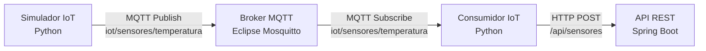

# Documentação de Arquitetura — DevOpsAC1

## Desafio 5 — Integração IoT e MQTT

### 1. Objetivo

Implementar uma integração IoT utilizando sensores simulados, comunicação MQTT e processamento de eventos, demonstrando o fluxo de dados até a plataforma Spring Boot.

A solução mantém a arquitetura de Monólito Modular adotada no projeto, adicionando componentes externos responsáveis pela publicação, distribuição e transformação dos eventos IoT.

### 2. Arquitetura C4 — Nível 2 (Contêineres)

### 3. Descrição dos componentes

| Componente | Tecnologia | Responsabilidade |
|---|---|---|
| Simulador IoT | Python | Gerar e publicar eventos de temperatura |
| Broker MQTT | Eclipse Mosquitto | Receber e distribuir mensagens MQTT |
| Consumidor IoT | Python / Paho MQTT | Receber, interpretar e transformar eventos |
| API REST | Java / Spring Boot | Receber os eventos processados via HTTP |

### 4. Fluxo de comunicação

1. O simulador gera eventos contendo identificação do sensor, temperatura e unidade de medida.
2. Os eventos são publicados no tópico MQTT `iot/sensores/temperatura`.
3. O broker Mosquitto encaminha as mensagens aos consumidores inscritos no tópico.
4. O consumidor interpreta o JSON e classifica temperaturas acima de 30 °C como `ALERTA` e as demais como `NORMAL`.
5. O evento transformado é enviado para a API Spring Boot por meio de uma requisição `POST /api/sensores`.
6. O Spring Boot recebe o evento e registra suas informações no log da aplicação.

### 5. Impacto na arquitetura existente

A integração IoT não altera as regras de negócio do módulo Aluno nem exige a decomposição do Core em microsserviços.

O Spring Boot permanece como aplicação única, enquanto o simulador, o broker MQTT e o consumidor funcionam como componentes externos de integração.

Essa abordagem permite evoluir a comunicação com dispositivos IoT sem modificar a estrutura principal da plataforma.

---

## ADR-002 — Integração IoT utilizando MQTT

### 1. Status
Aceito — Implementado no Desafio 5.

### 2. Contexto
A plataforma DevOpsAC1 precisava receber eventos gerados por sensores IoT simulados, permitindo a comunicação entre dispositivos externos e a aplicação Spring Boot.

Era necessário utilizar uma solução de comunicação leve, desacoplada e compatível com a arquitetura modular existente.

### 3. Alternativas consideradas

| Alternativa | Vantagens | Desvantagens |
|---|---|---|
| HTTP direto | Implementação simples | Maior acoplamento entre simulador e API |
| MQTT com Mosquitto | Comunicação leve, assíncrona e desacoplada | Exige configuração e manutenção de um broker |
| Kafka | Escalabilidade e processamento distribuído | Complexidade operacional elevada para o escopo do projeto |

### 4. Decisão arquitetural

Adotar o protocolo MQTT com o broker Eclipse Mosquitto para comunicação entre o simulador e o consumidor IoT.

O simulador e o consumidor foram desenvolvidos em Python, utilizando a biblioteca Paho MQTT.

O consumidor transforma os eventos recebidos e os encaminha à aplicação Spring Boot por HTTP REST.

O broker Mosquitto é executado em um contêiner Docker, configurado pelo Docker Compose.

### 5. Justificativa

A escolha do MQTT permite desacoplar a geração dos eventos de seu processamento.

O Mosquitto foi escolhido por ser leve, de código aberto e adequado à demonstração de comunicação IoT.

O Python facilita a simulação e o consumo dos eventos, enquanto a API REST permite integrar os dados ao Spring Boot sem alterar a arquitetura principal.

### 6. Consequências

**Positivas:**
- Separação entre publicação e consumo dos eventos.
- Possibilidade de adicionar novos consumidores MQTT.
- Integração com a aplicação existente.
- Reprodução do ambiente utilizando Docker Compose.

**Limitações:**
- Dependência da disponibilidade do broker MQTT.
- Necessidade de tratamento de falhas de comunicação.
- Configuração MQTT com acesso anônimo, adequada apenas ao ambiente de demonstração.
- Ausência de persistência dos eventos IoT na implementação atual.

### 7. Resultado

A integração foi validada por meio da publicação de eventos simulados, recebimento pelo consumidor MQTT, transformação dos dados e envio à API Spring Boot.

Os logs do consumidor e da aplicação demonstraram o funcionamento do fluxo completo.

A solução mantém o Core como Monólito Modular e adiciona uma integração externa baseada em eventos, sem introduzir microsserviços no domínio principal.

---

## Evidências — Desafio 5

### Consumidor MQTT

O consumidor recebeu os eventos publicados pelo simulador, transformou os dados e realizou o envio para a API Spring Boot.

### Integração com Spring Boot

Os logs da aplicação demonstram o recebimento dos eventos IoT pelo endpoint `/api/sensores`.

