# Arquitetura — B1 Architecture Lab

Documento cumulativo das decisões arquiteturais do case **Educação Continuada Gamificada**.

Cada desafio segue a trilha: **RF → RNF → ASR + RPC → alternativas → ADR → C4 → evidência**.

## Matriz cumulativa de ASRs

| Desafio | ASR | Decisão que ele dirige | ADR |
|---|---|---|---|
| D1 | Manutenibilidade | Organizar o Core por capacidades de negócio em um Monólito Modular | ADR-001 |
| D1 | Escalabilidade | Manter fronteiras modulares e permitir avaliar extração futura do Ranking com base em métricas | ADR-001 |
| D1 | Complexidade operacional | Manter um único processo, artefato e deploy | ADR-001 |
| D2 | Manutenibilidade | Separar domínio, aplicação, portas e adapters no módulo Aluno | ADR-002 |
| D2 | Testabilidade | Permitir testar casos de uso com adapter Fake, sem banco de dados | ADR-002 |
| D2 | Modificabilidade | Permitir substituir o adapter de persistência sem alterar o contrato da aplicação | ADR-002 |
| D3 | Deploy independente | Serviço Python (FastAPI) com imagem e ciclo de publicação próprios | ADR-003 |
| D3 | Tolerância a falhas | IA opcional: indisponibilidade retorna 503 sem bloquear fluxos do Core | ADR-003 |
| D3 | Escalabilidade | `ai-service` stateless, escalável separadamente do Core | ADR-003 |
| D4 | Tolerância a falhas / disponibilidade da conclusão | Notificação fora da transação (pós-commit, assíncrona) | ADR-004 |
| D4 | Desacoplamento (modificabilidade) | Core publica evento; publicador não conhece consumidores | ADR-004 |
| D4 | Consistência (imediata × eventual) | Recompensa síncrona; notificação eventual | ADR-004 |

---

## Mudança de arquitetura: de Camadas para Monólito Modular

> **Architecture Lab B1 — Desafio 1: Drivers e evolução do Core.**
> A mudança é **estrutural** (pacotes, visibilidade e regras de dependência): nenhuma regra de negócio, endpoint ou contrato HTTP é alterado. O Core continua com um único deploy, um único Spring Boot e o mesmo banco relacional.

### 1. Contexto

O MVP de gamificação evolui de ~1.000 usuários para até **100.000 usuários**. Ranking, Cursos, Conquistas e Recompensas continuam no Core, mas o **Ranking tende a crescer mais** que as demais capacidades.

A pergunta que guia a decisão:

> Há evidência suficiente para introduzir distribuição e deploy independente agora, ou uma modularização interna resolve o problema com menor custo operacional?

#### O que existe hoje no código da AC1

O repositório implementa a capacidade de **cursos extras por desempenho** (regra de recompensa do aluno):

| Regra | Onde está |
|---|---|
| Média **> 7,0** e curso concluído → 3 cursos extras | `domain.Aluno#processarEncerramentoDoCurso` |
| Média **= 7,0** e curso concluído → direito a recuperação | `domain.Aluno` |
| Média **< 7,0** → sem direito | `domain.Aluno` |
| Resgate de curso extra consome o saldo | `AlunoEntity#resgatarCursoExtra` / `AlunoService#resgatar` |

Ranking, Cursos, Conquistas e Recompensas **ainda não possuem módulos independentes implementados** neste repositório. Eles aparecem na estrutura-alvo como módulos previstos (esqueleto), para que a fronteira exista antes de a funcionalidade chegar.

---

### 2. Rastreabilidade da decisão

Regra de leitura: **RF/RNF → ASR + RPC → alternativas → ADR → C4 → evidência.**

| Elemento | Resumo |
|---|---|
| **RF** | RF01 Ranking · RF02 Conquistas/gamificação (recompensas por desempenho, como os cursos extras da AC1) |
| **RNF analisados** | Manutenibilidade, escalabilidade, complexidade operacional, desempenho, testabilidade |
| **ASR selecionados** | **Manutenibilidade**, **Escalabilidade**, **Complexidade operacional** |
| **Não são ASR agora** | Desempenho (sem medição de gargalo) e Testabilidade (melhora como efeito, mas não decide a macro-estrutura) |
| **RPC** | Java/Spring Boot · equipe de 4 devs · banco relacional existente · legado da AC1 (evolução incremental, sem reescrita) |
| **Alternativas** | A) Monólito em Camadas · B) **Monólito Modular** · C) Serviços independentes |
| **Decisão** | **B — Monólito Modular** (ADR-001) |

#### RPC e seus trade-offs

| RPC | O que ganhamos | O que aceitamos |
|---|---|---|
| Spring Boot (legado AC1) | Reuso total, sem reescrita | Fronteiras dependem de disciplina/ArchUnit, não do compilador |
| Equipe de 4 devs | Operação simples | Sem escala/deploy independente por módulo |
| Banco relacional único | Transações simples, sem nova tecnologia | Banco compartilhado entre módulos |
| Evolução incremental | Risco baixo, passos reversíveis | Convivência temporária entre estruturas |

#### Por que não ficar em camadas (A)?

Em camadas, qualquer classe de `service/` enxerga qualquer outra de `repository/` ou `entity/`. Conforme Ranking, Cursos, Conquistas e Recompensas crescem, o acoplamento entre capacidades aumenta sem que nada no código impeça. É funcional hoje, mas pouco preparada para a evolução prevista.

#### Por que não microsserviços (C)?

Seria prematuro: rede, contratos, observabilidade e tolerância a falhas distribuídas cairiam sobre 6 pessoas, e **não há medição** de latência/throughput provando gargalo. Hoje a distribuição custa mais do que resolve.

---

### 3. ADR-001 — Evoluir o Core de Monólito em Camadas para Monólito Modular

| Campo | Registro |
|---|---|
| **Status** | Aceito |
| **Contexto** | Crescimento até 100 mil usuários; Ranking cresce diferente; demais capacidades seguem evoluindo. |
| **ASRs** | Manutenibilidade; Escalabilidade; Complexidade operacional. |
| **RPCs** | Spring Boot; 4 desenvolvedores; banco relacional; legado AC1. |
| **Alternativas** | A) Monólito em Camadas; B) Monólito Modular; C) Decomposição seletiva em serviços. |
| **Decisão** | Adotar Monólito Modular e preservar uma fronteira clara para o Ranking (candidato a extração futura). |
| **Consequências positivas** | Separação de responsabilidades; menor acoplamento; evolução incremental; custo operacional bem menor que microsserviços. |
| **Trade-offs** | Deploy ainda conjunto; processo e banco compartilhados; Ranking ainda sem escala independente. |
| **Gatilho de revisão** | Reavaliar extração do Ranking quando métricas mostrarem gargalo, necessidade de escala própria ou de deploy independente. |

---

### 4. C4 — Contexto, Container, Componente e Código

#### 4.1 Nível 1 — Contexto

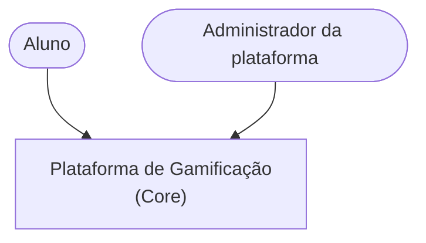


#### 4.2 Nível 2 — Container

A arquitetura escolhida mantém o Core como uma única aplicação Spring Boot, organizada internamente em módulos. A decisão pelo Monólito Modular não cria novos processos ou containers de aplicação.

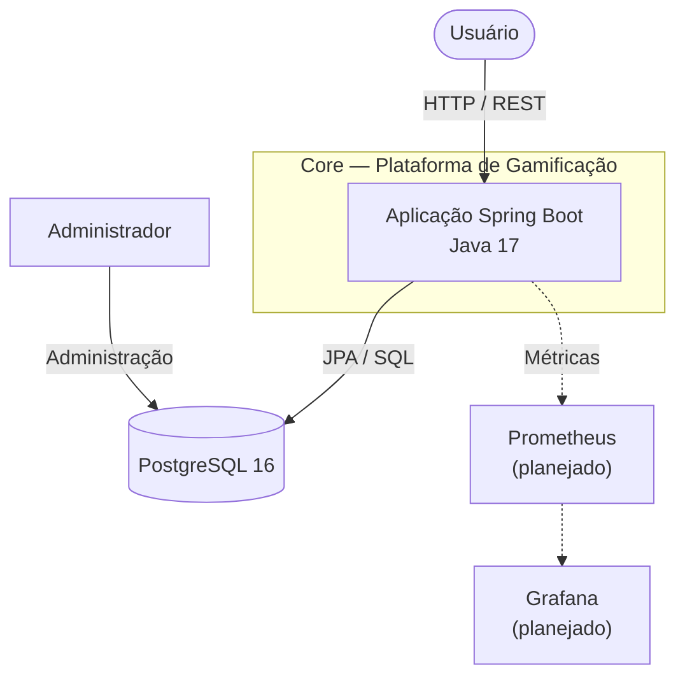

O Core permanece com um único artefato, uma única imagem Docker e um único deploy. A modularização ocorre dentro da aplicação, por meio da separação das capacidades de negócio.

O módulo Aluno é a funcionalidade reorganizada nesta etapa. Os módulos Ranking, Curso, Conquista e Recompensa representam capacidades previstas para a evolução do sistema, não containers independentes.

Prometheus e Grafana permanecem como componentes planejados para o desafio de CI/CD e Observabilidade.


#### 4.3 Nível 3 — Componente (dentro do Core)

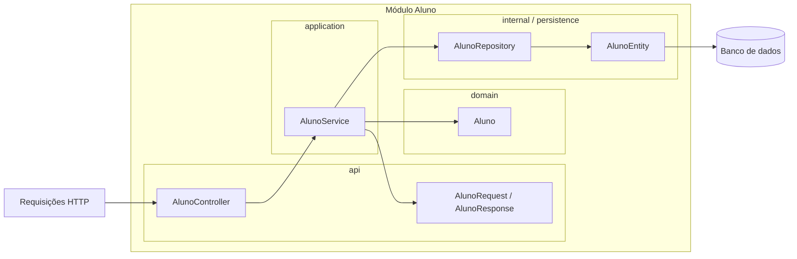

Quando outros módulos forem implementados, deverão acessar as funcionalidades de Aluno por contratos disponibilizados em `aluno.api`, nunca por `aluno.internal`.

#### 4.4 Nível 4 — Código
Exemplo do módulo `aluno`, com a estrutura resultante da refatoração da AC1.

**`aluno/api/AlunoController.java` — porta de entrada HTTP:**

```java
package org.example.ac1.aluno.api;

import org.example.ac1.aluno.application.AlunoService;
import org.springframework.http.HttpStatus;
import org.springframework.web.bind.annotation.*;

import java.util.List;

@RestController
@RequestMapping("/api/alunos")
public class AlunoController {

    private final AlunoService service;

    public AlunoController(AlunoService service) {
        this.service = service;
    }

    // Os endpoints HTTP delegam as operações ao serviço.
}
```

**`aluno/application/AlunoService.java` — coordenação dos casos de uso:**

```java
package org.example.ac1.aluno.application;

import org.example.ac1.aluno.api.AlunoRequest;
import org.example.ac1.aluno.api.AlunoResponse;
import org.example.ac1.aluno.domain.Aluno;
import org.example.ac1.aluno.internal.persistence.AlunoEntity;
import org.example.ac1.aluno.internal.persistence.AlunoRepository;
```

O serviço coordena as operações da funcionalidade, utiliza as regras do domínio e acessa a persistência para consultar e armazenar os dados. Também é responsável por montar as respostas da API, evitando que os DTOs dependam diretamente das entidades de persistência.

**`aluno/domain/Aluno.java` — regras de negócio:**

```java
package org.example.ac1.aluno.domain;

public class Aluno {

    private static final double MEDIA_MINIMA_PARA_CURSOS_EXTRAS = 7.0;
    private static final int QUANTIDADE_DE_CURSOS_EXTRAS = 3;

    public void processarEncerramentoDoCurso() {
        // Processamento da regra de negócio.
    }
}
```

A classe `Aluno` concentra as regras relacionadas ao encerramento do curso e à concessão de cursos extras, mantendo a lógica de negócio independente da infraestrutura.

**`aluno/internal/persistence/AlunoRepository.java` — acesso aos dados:**

```java
package org.example.ac1.aluno.internal.persistence;

import org.springframework.data.jpa.repository.JpaRepository;

public interface AlunoRepository
        extends JpaRepository<AlunoEntity, Long> {
}
```

**`aluno/internal/persistence/AlunoEntity.java` — entidade de persistência:**

A classe `AlunoEntity` representa a estrutura persistida no banco de dados, utilizando JPA para mapear os dados do aluno.

A organização permite separar as responsabilidades de cada parte do módulo. O Controller recebe as requisições HTTP, o Service coordena os casos de uso, o Domain concentra as regras de negócio e a camada de persistência gerencia o acesso aos dados.

Os demais módulos, quando implementados, deverão acessar a funcionalidade Aluno por meio de contratos disponibilizados em `aluno.api`, sem depender diretamente de `aluno.internal`.

### 4.5 Pipeline atual da AC1 (Jenkinsfile)

| Etapa | O que faz |
|---|---|
| 0 Preflight | Verifica Java, Docker, Compose e daemon |
| 1 Checkout | Baixa o código |
| 2 CI | `./mvnw clean test` + relatório JaCoCo |
| 3 Qualidade | PMD |
| 4 Package | Gera o `.jar` |
| 5 Build | `docker compose build app` |
| 6 Registry | Push no Docker Hub (opcional) |
| 7–8 Deploy HOMOL | `docker compose up` + health check em `/actuator/health` |
| 9 E2E | Cypress (opcional) |
| 10 Observabilidade | Hoje só imprime URLs; será substituída por Prometheus/Grafana |

A modularização não exige a divisão do pipeline: continuam previstos um artefato, uma imagem e um deploy. O Jenkinsfile existente ainda precisa ser revisado para validar suas referências e etapas.

### 4.6 Modular × Camadas

| Critério | Camadas (A) | Modular (B) |
|---|---|---|
| Organização | Por tipo técnico | Por capacidade de negócio |
| Onde mudar uma regra | Vários pacotes | Um módulo |
| Fronteiras | Não definidas por capacidade | Organizadas por convenção (`api` / `internal`), ainda sem imposição automática |
| Acoplamento entre capacidades | Livre, cresce com o tempo | Só via contrato |
| Testes | Espalhados | Por módulo |
| Extrair o Ranking depois | Muita reorganização | Fronteira já existe |
| Custo operacional | Baixo | Baixo (mesmo deploy) |
| Esforço inicial | Nenhum | Moderado (mover pacotes, regras) |

---

### 5. Antes × Depois

#### 5.1 Antes — organizado por camada técnica (estado anterior à refatoração)

```text
AC1/src/main/java/
├── domain/
│   └── Aluno.java                  ← fora do pacote base da aplicação
└── org/example/ac1/
    ├── Ac1Application.java
    ├── controller/AlunoController.java
    ├── dto/AlunoRequest.java
    ├── dto/AlunoResponse.java      ← conhece AlunoEntity e domain.Aluno
    ├── service/AlunoService.java
    ├── repository/AlunoRepository.java
    └── entity/AlunoEntity.java
```

Pontos de atenção identificados no código atual:

1. **Organização por camada:** para entender "recompensa por desempenho" é preciso navegar por 5 pacotes.
2. **Tudo é `public`:** nada impede que outro futuro módulo (ex.: Ranking) use `AlunoRepository` ou `AlunoEntity` diretamente.
3. **`AlunoResponse.de(AlunoEntity)`:** no estado anterior à refatoração, o DTO (camada de API) dependia da entidade JPA e do domínio, e ainda **executava regra de negócio** (`processarEncerramentoDoCurso`) ao montar a resposta. A API conhecia o interior.
4. **`domain.Aluno` fora de `org.example.ac1`:** o domínio fica solto, sem pertencer a nenhuma capacidade.

#### 5.2 Depois — organizado por capacidade de negócio (estado implementado)

```text
AC1/src/main/java/org/example/ac1/
├── Ac1Application.java
│
└── aluno/                              ← módulo implementado na AC1
    ├── api/                            ← interface pública do módulo
    │   ├── AlunoController.java
    │   ├── AlunoRequest.java
    │   └── AlunoResponse.java
    │
    ├── application/                    ← coordenação dos casos de uso
    │   └── AlunoService.java
    │
    ├── domain/                         ← regras de negócio
    │   └── Aluno.java
    │
    └── internal/                       ← implementação interna
        └── persistence/
            ├── AlunoEntity.java
            └── AlunoRepository.java
```

O módulo `aluno` concentra a funcionalidade de concessão e resgate de cursos extras por desempenho acadêmico.

As pastas `ranking`, `curso` e `conquista` representam capacidades previstas para a evolução da arquitetura, mas ainda não possuem implementação neste repositório.


#### 5.3 Mapa de movimentação

A refatoração reorganizou as classes da funcionalidade de Aluno, substituindo a estrutura baseada em camadas técnicas por uma estrutura organizada por capacidade de negócio.

| Classe | Pacote anterior | Pacote atual |
|---|---|---|
| `AlunoController` | `org.example.ac1.controller` | `org.example.ac1.aluno.api` |
| `AlunoRequest` | `org.example.ac1.dto` | `org.example.ac1.aluno.api` |
| `AlunoResponse` | `org.example.ac1.dto` | `org.example.ac1.aluno.api` |
| `AlunoService` | `org.example.ac1.service` | `org.example.ac1.aluno.application` |
| `Aluno` | `domain` | `org.example.ac1.aluno.domain` |
| `AlunoEntity` | `org.example.ac1.entity` | `org.example.ac1.aluno.internal.persistence` |
| `AlunoRepository` | `org.example.ac1.repository` | `org.example.ac1.aluno.internal.persistence` |

Além da movimentação das classes, foram realizadas as seguintes melhorias:

- Atualização dos imports e declarações de pacotes.
- Remoção das pastas antigas que ficaram vazias.
- Separação das responsabilidades entre API, aplicação, domínio e persistência.
- Remoção da dependência direta entre `AlunoResponse` e `AlunoEntity`.
- Transferência da montagem das respostas para `AlunoService`.
- Manutenção dos endpoints e das regras de negócio existentes.

A refatoração foi realizada incrementalmente, com execução dos testes após as movimentações para verificar a preservação do comportamento da aplicação.

#### Comparação das dependências antes e depois

**Antes da refatoração:**

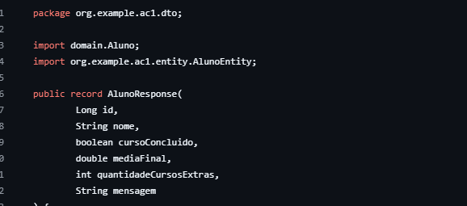

**Depois da refatoração:**

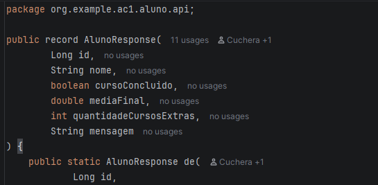

| Dependência | Antes da refatoração | Depois da refatoração |
|---|---|---|
| AlunoResponse → AlunoEntity | Existia | Removida |
| AlunoResponse → Aluno (domínio) | Existia | Removida |
| AlunoService → Aluno (domínio) | Existia | Mantida |
| AlunoService → AlunoRepository | Existia | Mantida, dentro do módulo |
| AlunoController → AlunoService | Existia | Mantida |

A principal redução de acoplamento ocorreu na camada de API. Anteriormente, `AlunoResponse` conhecia diretamente a entidade JPA e o domínio. Após a refatoração, a montagem das respostas passou a ser responsabilidade do `AlunoService`.

A persistência permanece encapsulada estruturalmente no pacote `aluno.internal.persistence`. Como nesta etapa existe apenas um módulo implementado, ainda não foi demonstrada uma dependência entre módulos distintos.

### 6. Regras de dependência

```text
        ┌────────────────────────────────────────────┐
        │  Módulo X                                  │
        │  ┌───────┐   usa    ┌──────────────────┐   │
 HTTP ─▶│  │  api  │ ───────▶ │     internal     │   │
        │  └───────┘          └──────────────────┘   │
        └───────▲────────────────────────────────────┘
                │  único ponto de contato permitido
        ┌───────┴────────┐
        │  Módulo Y      │   (nunca acessa X.internal)
        └────────────────┘
```

1. **`internal` é privado ao módulo.** Nenhuma classe de outro módulo pode importar `*.internal.*`.
2. **Módulos conversam só via `api`** (DTOs, interfaces/serviços de fachada expostos pelo módulo).
3. **`internal` nunca depende de `api` de outro módulo por atalho**: quando outros módulos precisarem acessar funcionalidades de Aluno, deverão utilizar contratos explícitos em `aluno.api`.
4. **Sem ciclos** entre módulos.
5. **Um banco, um deploy:** a modularização não separa schema nem processo (ver trade-offs do ADR).

---

### 7. Processo de refatoração — evolução incremental

A migração da arquitetura em camadas para o Monólito Modular foi realizada de forma incremental, utilizando o recurso **Refactor → Move** da IDE para reorganizar os pacotes e atualizar as referências entre as classes.

Cada etapa foi acompanhada pela execução dos testes automatizados, garantindo que as alterações estruturais não modificassem o comportamento funcional da aplicação.

#### 7.1 Etapas realizadas

1. **Criação do módulo Aluno:** criação do pacote `aluno`, que passou a concentrar as classes relacionadas à funcionalidade implementada na AC1.

2. **Organização da API:** movimentação de `AlunoController`, `AlunoRequest` e `AlunoResponse` para `aluno.api`.

3. **Organização da aplicação:** movimentação de `AlunoService` para `aluno.application`, mantendo a responsabilidade de coordenar os casos de uso.

4. **Organização do domínio:** movimentação da classe `Aluno` para `aluno.domain`, mantendo as regras de negócio separadas da infraestrutura.

5. **Organização da persistência:** movimentação de `AlunoEntity` e `AlunoRepository` para `aluno.internal.persistence`.

6. **Redução do acoplamento:** remoção da dependência direta entre `AlunoResponse` e `AlunoEntity`. A montagem da resposta passou a ser responsabilidade do `AlunoService`, mantendo o DTO independente da entidade JPA.

7. **Validação:** execução dos testes automatizados após as alterações, verificando a preservação do comportamento da aplicação.

#### 7.2 Resultado da refatoração

A estrutura anterior, organizada por camadas técnicas, foi substituída por uma organização baseada na funcionalidade de negócio.

O módulo Aluno passou a possuir separação entre API, aplicação, domínio e persistência interna.

A implementação mantém:
- Um único projeto Spring Boot;
- Um único processo de execução;
- Um banco de dados compartilhado;
- Os mesmos endpoints HTTP;
- As regras de negócio existentes.

#### 7.3 Melhorias arquiteturais futuras

Algumas melhorias podem ser implementadas em etapas posteriores:

- Restringir a visibilidade das classes internas, utilizando modificadores de acesso adequados.
- Adicionar testes de arquitetura com ArchUnit para impedir dependências externas em `internal`.
- Criar os módulos de Ranking, Curso e Conquista quando suas funcionalidades forem implementadas.
- Definir contratos explícitos na API para comunicação entre módulos.

Essas melhorias não são consideradas concluídas nesta etapa da refatoração.


### 8. Evidência: o comportamento foi preservado?

A validação da refatoração foi realizada por meio da execução da suíte de testes automatizados, garantindo que a reorganização dos pacotes e a separação das responsabilidades não alterassem o comportamento funcional da aplicação.

#### 8.1 Resultado dos testes

Após as alterações arquiteturais, foi executado o comando:

```powershell
.\mvnw.cmd test
```

O resultado apresentado pelo Maven foi:

| Indicador | Resultado |
|---|---:|
| Testes executados | 28 |
| Falhas | 0 |
| Erros | 0 |
| Testes ignorados | 0 |
| Resultado da compilação | BUILD SUCCESS |

Os resultados demonstram que todos os 28 testes foram executados com sucesso após a refatoração.

#### 8.2 Comparação arquitetural

| Critério | Antes | Depois |
|---|---|---|
| Organização | Por camadas técnicas | Por capacidade de negócio |
| Domínio | Pacote separado da aplicação | Dentro do módulo Aluno |
| API | Controller e DTOs distribuídos | Agrupados em `aluno.api` |
| Aplicação | Serviço em pacote global | `aluno.application` |
| Persistência | Entity e Repository em pacotes separados | Agrupados em `aluno.internal.persistence` |
| Dependência do DTO | AlunoResponse conhecia AlunoEntity | AlunoResponse independente da entidade JPA |
| Implantação | Um único Spring Boot | Um único Spring Boot |

#### 8.3 Preservação do comportamento

A refatoração foi realizada sem alterar intencionalmente os endpoints HTTP ou as regras de negócio existentes.

Os testes de integração e de domínio foram utilizados para verificar o funcionamento das operações relacionadas ao cadastro de alunos, encerramento de cursos, concessão e resgate de cursos extras.

A aprovação dos 28 testes indica que a reorganização arquitetural preservou os comportamentos cobertos pela suíte de testes.

#### 8.4 Evidências

Exemplo:


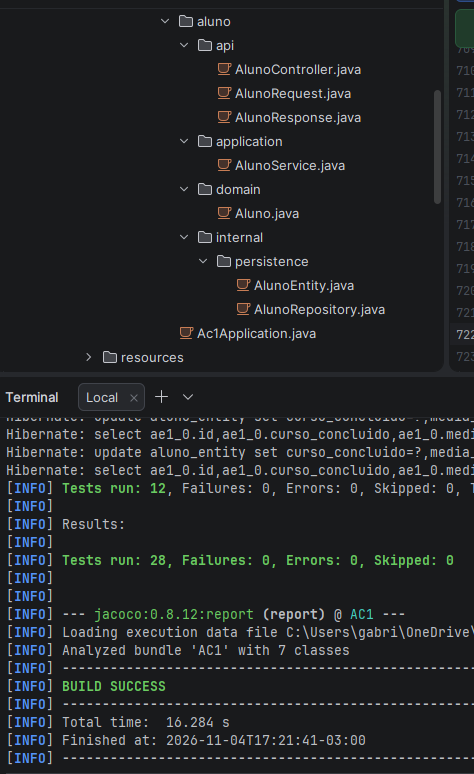


---

### 9. Impacto no pipeline (Jenkins)

A adoção do Monólito Modular não exige, por si só, a divisão do pipeline em múltiplos processos de build ou deploy. A aplicação continua sendo um único projeto Spring Boot, gerando um único artefato e utilizando uma única imagem Docker.

Dessa forma, a reorganização interna dos pacotes não altera o modelo de implantação da aplicação.

Entretanto, o Jenkinsfile existente ainda precisa de revisão para garantir que todas as etapas e referências de testes correspondam à estrutura atual do projeto.

---


### 10. Conclusão

A refatoração demonstrou que é possível reorganizar a funcionalidade de Aluno de uma arquitetura organizada por camadas técnicas para uma estrutura de Monólito Modular, sem introduzir comunicação distribuída ou alterar intencionalmente o comportamento funcional existente.

A implementação passou a separar as responsabilidades em quatro áreas:
- `api`: controladores e objetos de comunicação;
- `application`: coordenação dos casos de uso;
- `domain`: regras de negócio;
- `internal/persistence`: acesso e representação dos dados persistidos.

A execução dos testes automatizados apresentou 28 testes executados, sem falhas ou erros, indicando a preservação dos comportamentos cobertos pela suíte.

**O que ainda não foi implementado:** os módulos independentes de Ranking, Curso, Conquista e Recompensa. Eles permanecem como possibilidades de evolução da arquitetura.

**O que ainda precisa ser medido:** latência, throughput, consumo de recursos, frequência de deploy e contenção no banco de dados antes de considerar a extração de alguma capacidade para um microsserviço.

O Monólito Modular foi escolhido como uma evolução intermediária, permitindo melhorar a organização interna sem assumir antecipadamente a complexidade operacional de uma arquitetura distribuída.

---

# Architecture Lab B1 — Desafio 2: Organização interna do Core

## 11. Contexto do desafio

O Desafio 2 trata da organização interna do Core para proteger as regras de negócio contra dependências técnicas. As regras de ranking, moedas, conquistas e recompensas podem mudar com frequência. Por isso, a aplicação deve evitar que o domínio dependa diretamente do banco de dados, do Spring Data JPA ou de detalhes de infraestrutura.

O Core continua sendo uma aplicação Spring Boot. A proposta é evoluir a estrutura existente de forma incremental, sem reescrever o produto.

### 11.1 Requisitos e atributos de qualidade considerados

| Tipo | Identificação | Descrição |
|---|---|---|
| RF | RF01 | Disponibilizar o ranking de alunos. |
| RF | RF02 | Controlar conquistas e regras de gamificação. |
| RNF | — | Manutenibilidade: permitir alterar regras com menor impacto em outras partes do sistema. |
| RNF | — | Testabilidade: permitir testar regras sem depender de banco de dados ou infraestrutura. |
| RNF | — | Modificabilidade: permitir substituir detalhes técnicos sem reescrever o domínio. |

### 11.2 ASRs selecionados

| ASR | Influência na arquitetura |
|---|---|
| **Manutenibilidade** | As regras de negócio ficam concentradas no domínio e os detalhes de persistência ficam atrás de uma abstração. |
| **Testabilidade** | O caso de uso trabalha com uma porta, permitindo utilizar um adapter Fake nos testes. |
| **Modificabilidade** | A implementação JPA pode ser substituída por outra implementação da porta sem alterar o contrato utilizado pelo serviço. |
### 11.3 Influência dos ASRs nas dimensões arquiteturais

| Dimensão | Como os ASRs influenciam a arquitetura |
|---|---|
| **Estrutura** | A separação entre domínio, aplicação, portas e adapters reduz o acoplamento e facilita a manutenção e evolução das regras de negócio. |
| **Comunicação** | O `AlunoService` utiliza o contrato `AlunoPort` para acessar a persistência, sem conhecer diretamente a implementação concreta. |
| **Dados** | O objeto `AlunoDados` desacopla a aplicação da entidade JPA. O adapter realiza o mapeamento entre os dados da aplicação e a persistência. |
| **Implantação** | A aplicação permanece como um único projeto Spring Boot, sem necessidade de criar novos serviços ou containers. |
| **Operação** | O adapter Fake permite executar testes sem banco de dados. No ambiente de produção, a persistência continua utilizando o adapter JPA e o PostgreSQL. |

### 11.4 Restrições do problema (RPC)

- Manter o Core em Spring Boot.
- Reaproveitar as regras e o código existente, sem reescrita integral.
- Fazer a mudança de forma incremental.
- Preservar o banco relacional existente.
- Evitar que os casos de uso dependam diretamente de classes do Spring Data JPA.

## 12. Alternativas arquiteturais

| Alternativa | Vantagens | Custos e limitações |
|---|---|---|
| **A — Dependência direta de JPA** | Simples e familiar; menor quantidade de abstrações. | O serviço conhece o repositório concreto; testes e mudanças de persistência ficam mais dependentes da infraestrutura. |
| **B — Ports & Adapters (Hexagonal)** | O caso de uso depende de uma porta; adapters implementam detalhes técnicos; facilita Fake/Mock e substituição da persistência. | Introduz interfaces, mapeamento de dados e classes adicionais. |
| **C — Clean Architecture / Onion** | Reforça a regra de dependência apontando para o núcleo. | Pode introduzir uma estrutura mais ampla do que a necessária para a mudança incremental. |
| **D — DDD tático** | Entidades e objetos de valor ajudam a modelar regras complexas do negócio. | DDD não substitui sozinho uma estratégia de inversão de dependência; aplicar todos os padrões agora pode ser desproporcional. |

### Decisão

Foi adotado **Ports & Adapters (Arquitetura Hexagonal) de forma incremental no módulo Aluno**. A decisão complementa o Monólito Modular do Desafio 1: a separação por capacidades organiza o Core, enquanto a arquitetura hexagonal define a direção das dependências dentro do módulo.

Clean Architecture e Onion possuem princípios compatíveis de dependência direcionada ao núcleo. DDD tático pode ser aplicado onde a complexidade das regras justificar, mas não foi adotado como uma reestruturação completa.

## 13. ADR-002 — Inverter a dependência de persistência do módulo Aluno

| Campo | Registro |
|---|---|
| **Status** | Aceito / implementado no fluxo de persistência do módulo Aluno |
| **Contexto** | `AlunoService` acessava diretamente o repositório JPA, aproximando o caso de uso de uma tecnologia específica e dificultando testes sem infraestrutura. |
| **ASRs** | Manutenibilidade, testabilidade e modificabilidade. |
| **RPCs** | Manter Spring Boot; preservar o banco relacional; reaproveitar o domínio existente; realizar evolução incremental. |
| **Alternativas** | Dependência direta de JPA; Ports & Adapters; Clean/Onion; DDD tático como apoio à modelagem. |
| **Decisão** | Criar a porta de saída `AlunoPort`, fazer `AlunoService` depender dela e implementar adapters para JPA e Fake. |
| **Consequências positivas** | O serviço deixa de depender diretamente de `AlunoRepository`; a persistência pode ser substituída; testes podem usar dados em memória. |
| **Trade-offs** | Há uma interface adicional, um objeto de dados para atravessar a fronteira e mapeamento entre o modelo da aplicação e a entidade JPA. |
| **Limites atuais** | A inversão foi aplicada ao fluxo de persistência de Aluno. Isso não significa que todos os módulos e integrações já sigam Hexagonal. |
| **Gatilho de revisão** | Revisar a abstração se surgirem novos adapters, múltiplas fontes de dados ou complexidade excessiva no mapeamento. |

### 13.1 Dependência invertida

**Antes:**

```text
AlunoController
      |
      v
AlunoService
      |
      v
AlunoRepository (Spring Data JPA)
      |
      v
AlunoEntity
      |
      v
PostgreSQL
```

**Depois:**

```text
AlunoController
      |
      v
AlunoService ---------> AlunoPort
                           ^
                           |
                    AlunoJpaAdapter
                           |
                    AlunoRepository
                           |
                      AlunoEntity
                           |
                       PostgreSQL

Nos testes:

AlunoService ---------> AlunoPort
                           ^
                           |
                    AlunoFakeAdapter
                    (dados em memória)
```

O serviço depende do contrato `AlunoPort`, enquanto os adapters implementam esse contrato. O tipo `AlunoDados` evita expor `AlunoEntity` para a camada de aplicação.

## 14. C4 — Componentes do módulo Aluno após a inversão

O diagrama representa o fluxo de persistência do módulo Aluno após o Desafio 2. O adapter Fake é utilizado nos testes e não faz parte do deploy de produção.

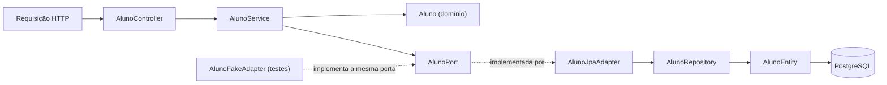

| Componente | Responsabilidade |
|---|---|
| `AlunoController` | Receber requisições HTTP e delegar operações ao serviço. |
| `AlunoService` | Coordenar os casos de uso e utilizar a porta de persistência. |
| `Aluno` | Concentrar as regras de domínio relacionadas ao encerramento do curso e aos cursos extras. |
| `AlunoPort` | Definir o contrato de saída utilizado pela aplicação para listar, consultar e salvar dados de aluno. |
| `AlunoJpaAdapter` | Implementar a porta utilizando o repositório JPA e realizar o mapeamento dos dados. |
| `AlunoRepository` | Executar operações de persistência por meio do Spring Data JPA. |
| `AlunoEntity` | Representar os dados persistidos com mapeamento JPA. |
| `AlunoFakeAdapter` | Implementar a mesma porta em memória, para testes sem banco de dados. |

## 15. Mini-lab — Substituição do adapter de persistência

O mini-lab demonstra que a camada de aplicação pode trabalhar com o contrato `AlunoPort`, sem precisar conhecer qual implementação está fornecendo os dados.

### 15.1 Porta de saída

A interface `AlunoPort` define operações de listagem, consulta por identificador e salvamento. O tipo `AlunoDados` representa os dados necessários à aplicação e não expõe a entidade JPA.

```java
package org.example.ac1.aluno.application.port.out;

import java.util.List;
import java.util.Optional;

public interface AlunoPort {
    List<AlunoDados> listar();
    Optional<AlunoDados> buscarPorId(Long id);
    AlunoDados salvar(AlunoDados aluno);

    record AlunoDados(
        Long id,
        String nome,
        boolean cursoConcluido,
        double mediaFinal,
        int quantidadeCursosExtras
    ) {}
}
```

### 15.2 Adapter JPA

`AlunoJpaAdapter`, localizado em `aluno.internal.persistence`, implementa `AlunoPort` e utiliza `AlunoRepository` para persistir os dados. A camada de aplicação conhece somente o contrato, não a implementação JPA.

### 15.3 Adapter Fake

`AlunoFakeAdapter`, localizado no código de teste, implementa o mesmo contrato utilizando uma coleção em memória. Assim, é possível validar operações sem iniciar PostgreSQL ou depender de uma instância de JPA.

O Fake é uma implementação de teste e não deve ser utilizado no ambiente de produção.

### 15.4 O que o mini-lab demonstra

- O serviço depende de uma abstração (`AlunoPort`), e não de `AlunoRepository`.
- O adapter JPA concentra o acesso à tecnologia de persistência.
- O adapter Fake permite exercitar o contrato com armazenamento em memória.
- A regra de domínio `Aluno` pode ser testada sem banco de dados.
- A mudança foi feita sem reescrever o Core ou remover Spring Boot.

## 16. Evolução das regras de domínio de gamificação

Além da inversão de dependência no módulo Aluno, foram criadas classes iniciais para representar regras de Ranking, Conquista e Recompensa. Elas são provas de conceito de domínio e não representam funcionalidades de produto totalmente integradas.

### 16.1 Ranking

A classe `PontuacaoRanking` mantém a pontuação de um aluno e concentra operações de registro de participação. Para o mini-lab, foi adotada a seguinte regra de pontuação:

| Participação | Pontos |
|---|---:|
| Criar um tópico no fórum | 2 |
| Publicar um comentário útil | 1 |

`RankingService` ordena as pontuações de forma decrescente.

A pontuação numérica é uma decisão de implementação adotada para tornar a regra verificável. O requisito do exercício descreve a participação no fórum e a recompensa mensal, mas não define valores numéricos para cada ação. A concessão mensal de um curso ao vencedor ainda depende de integração com dados do fórum, período mensal e catálogo de cursos; esse fluxo completo não está demonstrado nesta implementação.

### 16.2 Conquistas

A classe `Conquista` representa uma conquista com uma quantidade mínima de cursos concluídos. O método de verificação desbloqueia a conquista quando a quantidade informada atinge o limite definido.

A implementação cobre a regra isolada de desbloqueio. Não há, nesta etapa, catálogo persistido de conquistas ou integração completa com todos os eventos da plataforma.

### 16.3 Recompensas

Foram criadas duas classes iniciais:

- `CarteiraMoedas`: controla saldo, adição e gasto de moedas, impedindo quantidades inválidas ou gastos superiores ao saldo.
- `ProgressaoAluno`: acompanha cursos concluídos e, ao atingir o limite definido na implementação, ativa o plano Premium, disponibiliza um indicador de voucher e credita moedas.

Essas regras são exemplos de domínio isolado. O resgate real de voucher, a integração com pagamentos/planos e a persistência dessas informações não fazem parte do mini-lab concluído.

## 17. Evidências e validação

A validação do Desafio 2 deve demonstrar a preservação das regras e a substituição do adapter.

| Evidência | O que comprova |
|---|---|
| Testes de `Aluno` | Regras de encerramento do curso e concessão de cursos extras sem depender da persistência. |
| Testes de `AlunoFakeAdapter` | Operações do contrato usando armazenamento em memória. |
| Testes de `AlunoJpaAdapter` | Mapeamento entre o contrato da aplicação e a persistência JPA. |
| Testes de Ranking, Conquista e Recompensa | Regras de domínio isoladas para as novas capacidades. |
| Resultado do Maven | Compilação e execução da suíte de testes. |
| Histórico Git | Evolução incremental e versionada da mudança. |

### 17.1 Comando de validação

```powershell
.\mvnw.cmd clean test
```

Preencher a tabela abaixo com o resultado da execução final, após todas as alterações do Desafio 2:

| Indicador | Resultado |
|---|---|
| Testes executados | 59 |
| Falhas | 0 |
| Erros | 0 |
| Ignorados | 0 |
| Build | (`BUILD SUCCESS`) |

Não foi registrado aqui um percentual global de cobertura do projeto. Os percentuais do JaCoCo devem ser informados por classe ou pacote somente quando acompanhados do relatório correspondente; a cobertura de uma classe não representa automaticamente a cobertura total da aplicação.

### 17.2 Histórico de implementação

A evolução do Desafio 2 foi realizada incrementalmente: criação das regras de domínio, introdução da porta de saída, implementação do adapter JPA, implementação do Fake para testes e ampliação dos testes automatizados.

Os commits do Git devem ser mantidos como evidência do desenvolvimento por etapas. O histórico do repositório é a fonte para identificar os hashes e as datas efetivas de cada alteração.

## 18. Consequências e próximos passos

### Benefícios obtidos

- `AlunoService` deixou de depender diretamente do repositório JPA.
- A persistência passou a ser acessada por meio de uma porta definida pela aplicação.
- O adapter Fake permite testar o contrato sem banco de dados.
- As regras de domínio de Ranking, Conquista e Recompensa começaram a ser isoladas em classes próprias.
- A evolução preserva o Core Spring Boot e a estratégia de Monólito Modular definida no Desafio 1.

### Limitações e trabalho futuro

- Aplicar portas e adapters às demais integrações somente quando houver necessidade concreta.
- Avaliar testes de arquitetura (por exemplo, ArchUnit) para reforçar as regras de dependência entre pacotes.
- Integrar a pontuação do Ranking aos eventos reais do fórum e ao fechamento mensal.
- Integrar Conquistas e Recompensas ao fluxo de conclusão de cursos.
- Definir persistência e contratos para moedas, vouchers e progressão Premium.
- Registrar e anexar o resultado final do Maven e os relatórios JaCoCo atualizados.

### Conclusão do Desafio 2

A decisão adotada protege o núcleo da aplicação contra detalhes de persistência ao introduzir Ports & Adapters no módulo Aluno. O caso de uso depende de `AlunoPort`, enquanto as implementações JPA e Fake ficam atrás do mesmo contrato. Isso permite substituir a tecnologia de persistência e testar o fluxo com uma implementação em memória, sem reescrever o Core.

A mudança complementa o Monólito Modular do Desafio 1: a separação por capacidade organiza o Core, enquanto a arquitetura hexagonal define a direção das dependências dentro do módulo. As novas regras de Ranking, Conquista e Recompensa foram iniciadas como provas de conceito, mantendo explícitas as integrações que ainda precisam ser desenvolvidas.
"""

---

## Desafio 3 — Serviço Python e IA

### Rastreabilidade

| Requisito | RNF/ASR | RPC | Decisão | Evidência |
|---|---|---|---|---|
| RF03 Recomendação inteligente | Deploy independente, tolerância a falhas, escalabilidade | Core continua Java; IA pode ficar indisponível | FastAPI separado, consumido por REST | [evidência do mini-lab](../../evidencias/BDD3-IA.md) |
| RF04 Assistente educacional | Deploy independente, tolerância a falhas, escalabilidade | ML/RAG permanecem fora do Core | Mesma fronteira de IA inicialmente, com endpoints independentes | [evidência do mini-lab](../../evidencias/BDD3-IA.md) |

### ASRs selecionados

- **Deploy independente:** o serviço Python tem imagem e ciclo de publicação próprios, sem recompilar o Core Java.
- **Tolerância a falhas:** recomendações e assistente são capacidades opcionais; a indisponibilidade retorna `503` explícito e não impede operações de alunos.
- **Escalabilidade:** a API FastAPI é stateless e pode ser replicada separadamente do Core conforme a carga de inferência.

### ADR-003 — Fronteira de IA

#### Contexto

Recomendação e assistência educacional exigem modelos Python com atualização e carga diferentes do Core. A indisponibilidade dessas capacidades não pode bloquear o cadastro, conclusão ou resgate de cursos.

#### Alternativas

- **A — IA embutida no Core:** menor latência de chamada, mas mistura runtimes, deploys e escala, além de aumentar o impacto de falhas de modelo.
- **B — módulo Python acoplado ao Core:** separa o runtime parcialmente, mas mantém o mesmo ciclo operacional e dificulta isolamento de recursos.
- **C — serviço Python independente:** permite deploy, escala e recuperação independentes; adiciona uma chamada REST e observabilidade de outro serviço.

#### Decisão

Adotar a alternativa C. ML e RAG ficam na mesma fronteira `ai-service` neste estágio, com endpoints REST independentes (`/recommendations` e `/assistant`). A separação entre serviços só será feita quando houver escala, segurança, dados ou ciclo de atualização significativamente diferentes.

O Core chama FastAPI por REST. Quando a chamada falha, o endpoint de IA devolve `503` com `disponivel=false`; os fluxos essenciais do Core continuam isolados e operacionais.

#### Consequências e trade-offs

- Positivas: deploy e escala independentes, isolamento de falhas e interoperabilidade por HTTP/JSON.
- Negativas: novo container para operar, latência de rede e necessidade de métricas, timeout e evolução de contrato.
- O mini-lab usa respostas determinísticas para provar a fronteira; modelos reais podem substituir a implementação sem alterar o contrato do Core.

### C4 — Container

```text
[Usuário]
    |
    v
[Core Java/Spring Boot] -- REST/JSON --> [AI Service/FastAPI]
    |                                      |-- ML: recomendação
    |                                      `-- RAG/LLM: assistente
    `-- PostgreSQL
```

O `docker-compose.yml` executa os containers separadamente. A URL é configurável por `AI_SERVICE_BASE_URL`, permitindo o mesmo Core em desenvolvimento, homologação e produção.

---


## Desafio 4 — Comunicação e Eventos

**Problema:** ao concluir um curso, registrar a conclusão e calcular a recompensa **sem** que uma falha de notificação impeça a conclusão.

### Rastreabilidade

RF02 / RF05 → RNF (tolerância a falhas, desacoplamento, consistência) → ASR + RPC → alternativas → **ADR-004** → C4 Container + sequência → `CursoConcluidoEventosTest` + prints.

### Requisitos funcionais afetados

- **RF02 — Conquistas:** concluir curso e conceder 3 cursos extras quando a média for superior a 7,0 (`AlunoService.cadastrar` / `concluirOutroCurso`, rota `POST /api/alunos/processar-encerramento`).
- **RF05 — Notificações:** avisar o aluno sobre a conclusão e a recompensa (novo módulo `notificacao`).

### RNF analisados (FURPS+)

Tolerância a falhas, disponibilidade, latência, consistência, desacoplamento, recuperabilidade.

### ASRs escolhidos

| ASR | Por que altera a arquitetura |
|---|---|
| Tolerância a falhas / disponibilidade da conclusão | Exige que a notificação rode **fora** da transação e da thread da conclusão: muda o estilo de comunicação e a fronteira transacional. |
| Desacoplamento | O módulo `aluno` publica um fato e não conhece consumidores: inverte a direção das dependências entre módulos. |
| Consistência (imediata × eventual) | Define o que é síncrono (recompensa na resposta HTTP) e o que é eventual (notificação/analytics). |

Latência e recuperabilidade foram tratadas como consequências, não como ASRs: o volume do case é baixo e não há exigência de reprocessamento.

### Restrições e premissas (RPC)

- Operações essenciais do Core devem concluir mesmo com consumidor externo indisponível.
- Adotar broker tem custo operacional (equipe de 6, esteira Jenkins e `docker-compose` existentes).
- Core permanece em Java/Spring Boot com banco relacional (H2 local, PostgreSQL no compose).

### Imediato × eventual

| Imediato (síncrono, mesma transação) | Eventual (assíncrono, após o commit) |
|---|---|
| Validar a requisição, registrar o resultado, calcular e conceder cursos extras | Notificar o aluno; analytics |

### Alternativas e trade-offs

| | A) REST síncrono para o notificador | B) Eventos de domínio in-process, assíncronos pós-commit | C) Broker (RabbitMQ / Kafka) |
|---|---|---|---|
| Falha do consumidor | Propaga erro e **desfaz a conclusão** | Isolada; conclusão confirmada | Isolada; mensagem fica na fila |
| Acoplamento | Core conhece o endpoint do notificador | Core só publica um fato | Core só publica um fato |
| Custo operacional | Baixo | Nenhum componente novo | Novo componente para operar, monitorar e versionar |
| Durabilidade do evento | n/a | **Não durável** | Durável |
| Quando faz sentido | A resposta do outro lado é necessária agora | Consumidor no mesmo processo, baixo volume | Consumidor em outro processo, retentativa/entrega garantida |

**RabbitMQ × Kafka:** o fluxo é uma fila de tarefas de baixo volume, sem replay nem log retido; RabbitMQ atenderia. Kafka só se justificaria com alto throughput ou reprocessamento histórico.

### ADR-004 — Notificação de conclusão via eventos assíncronos pós-commit

- **Status:** Aceito
- **Contexto:** a conclusão de curso registra o resultado e concede cursos extras; notificação e analytics são secundários e não podem impedir a conclusão. Hoje não existe consumidor fora do processo do Core, e um broker teria custo operacional.
- **ASRs / RPCs:** tolerância a falhas; desacoplamento; consistência imediata apenas para a recompensa; Core em Spring Boot; custo operacional de broker.
- **Alternativas consideradas:** REST síncrono; eventos in-process assíncronos; broker (RabbitMQ/Kafka).
- **Decisão:** o `AlunoService` publica `CursoConcluidoEvent` após registrar o resultado. O módulo `notificacao` consome com `@TransactionalEventListener(phase = AFTER_COMMIT)` + `@Async`, capturando e registrando falhas. A recompensa permanece síncrona. Não adotamos broker nesta etapa.
- **Consequências:**
  - (+) Falha do consumidor não desfaz a conclusão (evidência: `CursoConcluidoEventosTest`).
  - (+) Só notifica o que de fato foi gravado (`AFTER_COMMIT`).
  - (+) Nenhum componente de infraestrutura novo.
  - (−) Evento **não durável**: se a JVM cair entre o commit e o listener, a notificação se perde.
  - (−) Sem retentativa automática.
  - (−) `@TransactionalEventListener` ignora eventos publicados fora de transação; o `AlunoService` precisa continuar `@Transactional`.
  - **Gatilho de revisão:** consumidor em outro processo (ex.: serviço Python, MQTT) ou exigência de entrega garantida → adotar *transactional outbox* + RabbitMQ.

### C4 — Container (nível afetado)

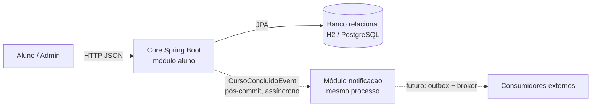

### Sequência do fluxo crítico

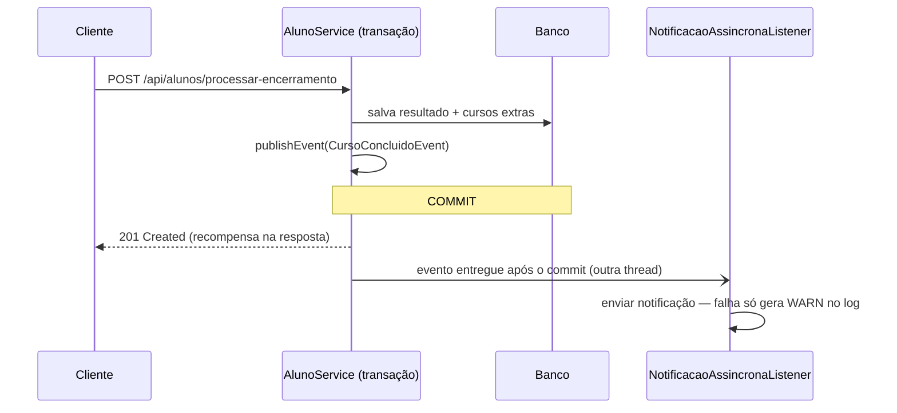

### Implementação

| Arquivo | Papel |
|---|---|
| `AC1/src/main/java/org/example/ac1/aluno/application/CursoConcluidoEvent.java` | Evento de domínio |
| `AC1/src/main/java/org/example/ac1/aluno/application/AlunoService.java` | Publica o evento após salvar |
| `AC1/src/main/java/org/example/ac1/config/AsyncConfig.java` | `@EnableAsync` |
| `AC1/src/main/java/org/example/ac1/notificacao/NotificacaoSender.java` | Porta do consumidor |
| `AC1/src/main/java/org/example/ac1/notificacao/LogNotificacaoSender.java` | Consumidor simulado (pode simular indisponibilidade) |
| `AC1/src/main/java/org/example/ac1/notificacao/NotificacaoAssincronaListener.java` | **Decisão**: pós-commit + assíncrono (padrão) |
| `AC1/src/main/java/org/example/ac1/notificacao/NotificacaoSincronaListener.java` | Baseline acoplado, só para contraprova |

Propriedades: `app.notificacao.modo` (`assincrono` padrão | `sincrono`) e `app.notificacao.simular-indisponibilidade` (`false` padrão).

### Evidência

| Hipótese | Teste | Resultado esperado |
|---|---|---|
| Acoplamento síncrono faz a falha do consumidor derrubar a conclusão | `Sincrono.falhaDeNotificacaoDerrubaAConclusaoEFazRollback` | Exceção + nenhum aluno persistido |
| A decisão preserva a conclusão com consumidor fora do ar | `AssincronoComConsumidorIndisponivel.conclusaoPersisteMesmoComConsumidorForaDoAr` | 3 cursos extras + aluno persistido |
| Caminho feliz | `AssincronoComConsumidorDisponivel.*` | Notificação após o commit; curso não concluído não publica evento |
| No modo síncrono a notificação ocorre antes da resposta | `SincronoComConsumidorDisponivel.notificacaoAconteceAntesDaRespostaNaMesmaThread` | Notificação já registrada quando o método retorna |

Resultado: **5 testes verdes**, **100% de cobertura JaCoCo** (579/579 instruções, 42/42 branches).

| Síncrono (baseline acoplado) | Assíncrono pós-commit (decisão) |
|---|---|
| 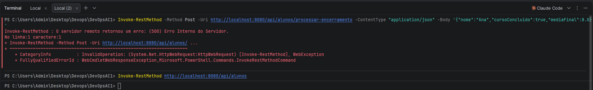 | 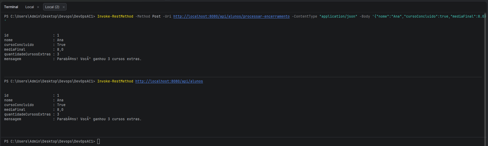 |
| 500 + aluno **não** gravado | 201 + aluno gravado com 3 cursos extras |

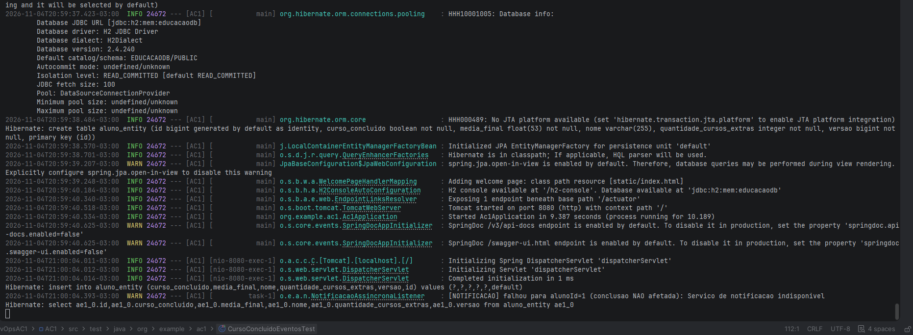

Demais evidências (testes e JaCoCo): [`evidencias/B1-desafio-4/`](../../evidencias/B1-desafio-4/)


# Documentação de Arquitetura — DevOpsAC1

## Desafio 5 — Integração IoT e MQTT

### 1. Objetivo

Implementar uma integração IoT utilizando sensores simulados, comunicação MQTT e processamento de eventos, demonstrando o fluxo de dados até a plataforma Spring Boot.

A solução mantém a arquitetura de Monólito Modular adotada no projeto, adicionando componentes externos responsáveis pela publicação, distribuição e transformação dos eventos IoT.

### 2. Arquitetura C4 — Nível 2 (Contêineres)

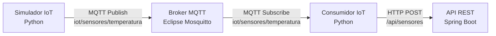

### 3. Descrição dos componentes

| Componente | Tecnologia | Responsabilidade |
|---|---|---|
| Simulador IoT | Python | Gerar e publicar eventos de temperatura |
| Broker MQTT | Eclipse Mosquitto | Receber e distribuir mensagens MQTT |
| Consumidor IoT | Python / Paho MQTT | Receber, interpretar e transformar eventos |
| API REST | Java / Spring Boot | Receber os eventos processados via HTTP |

### 4. Fluxo de comunicação

1. O simulador gera eventos contendo identificação do sensor, temperatura e unidade de medida.
2. Os eventos são publicados no tópico MQTT `iot/sensores/temperatura`.
3. O broker Mosquitto encaminha as mensagens aos consumidores inscritos no tópico.
4. O consumidor interpreta o JSON e classifica temperaturas acima de 30 °C como `ALERTA` e as demais como `NORMAL`.
5. O evento transformado é enviado para a API Spring Boot por meio de uma requisição `POST /api/sensores`.
6. O Spring Boot recebe o evento e registra suas informações no log da aplicação.

### 5. Impacto na arquitetura existente

A integração IoT não altera as regras de negócio do módulo Aluno nem exige a decomposição do Core em microsserviços.

O Spring Boot permanece como aplicação única, enquanto o simulador, o broker MQTT e o consumidor funcionam como componentes externos de integração.

Essa abordagem permite evoluir a comunicação com dispositivos IoT sem modificar a estrutura principal da plataforma.


---

## ADR-005 — Integração IoT utilizando MQTT

### 1. Status
Aceito — Implementado no Desafio 5.

### 2. Contexto
A plataforma DevOpsAC1 precisava receber eventos gerados por sensores IoT simulados, permitindo a comunicação entre dispositivos externos e a aplicação Spring Boot.

Era necessário utilizar uma solução de comunicação leve, desacoplada e compatível com a arquitetura modular existente.

### 3. Alternativas consideradas

| Alternativa | Vantagens | Desvantagens |
|---|---|---|
| HTTP direto | Implementação simples | Maior acoplamento entre simulador e API |
| MQTT com Mosquitto | Comunicação leve, assíncrona e desacoplada | Exige configuração e manutenção de um broker |
| Kafka | Escalabilidade e processamento distribuído | Complexidade operacional elevada para o escopo do projeto |

### 4. Decisão arquitetural

Adotar o protocolo MQTT com o broker Eclipse Mosquitto para comunicação entre o simulador e o consumidor IoT.

O simulador e o consumidor foram desenvolvidos em Python, utilizando a biblioteca Paho MQTT.

O consumidor transforma os eventos recebidos e os encaminha à aplicação Spring Boot por HTTP REST.

O broker Mosquitto é executado em um contêiner Docker, configurado pelo Docker Compose.

### 5. Justificativa

A escolha do MQTT permite desacoplar a geração dos eventos de seu processamento.

O Mosquitto foi escolhido por ser leve, de código aberto e adequado à demonstração de comunicação IoT.

O Python facilita a simulação e o consumo dos eventos, enquanto a API REST permite integrar os dados ao Spring Boot sem alterar a arquitetura principal.

### 6. Consequências

**Positivas:**
- Separação entre publicação e consumo dos eventos.
- Possibilidade de adicionar novos consumidores MQTT.
- Integração com a aplicação existente.
- Reprodução do ambiente utilizando Docker Compose.

**Limitações:**
- Dependência da disponibilidade do broker MQTT.
- Necessidade de tratamento de falhas de comunicação.
- Configuração MQTT com acesso anônimo, adequada apenas ao ambiente de demonstração.
- Ausência de persistência dos eventos IoT na implementação atual.

### 7. Resultado

A integração foi validada por meio da publicação de eventos simulados, recebimento pelo consumidor MQTT, transformação dos dados e envio à API Spring Boot.

Os logs do consumidor e da aplicação demonstraram o funcionamento do fluxo completo.

A solução mantém o Core como Monólito Modular e adiciona uma integração externa baseada em eventos, sem introduzir microsserviços no domínio principal.


---

## Evidências — Desafio 5

### Consumidor MQTT

O consumidor recebeu os eventos publicados pelo simulador, transformou os dados e realizou o envio para a API Spring Boot.

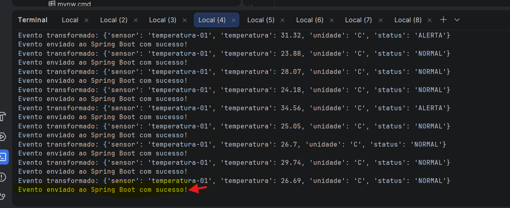

### Integração com Spring Boot

Os logs da aplicação demonstram o recebimento dos eventos IoT pelo endpoint `/api/sensores`.

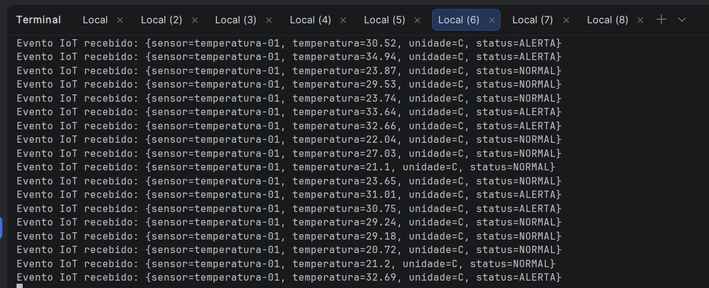