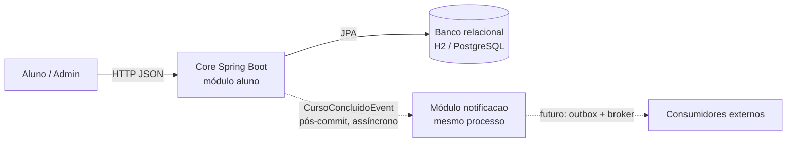
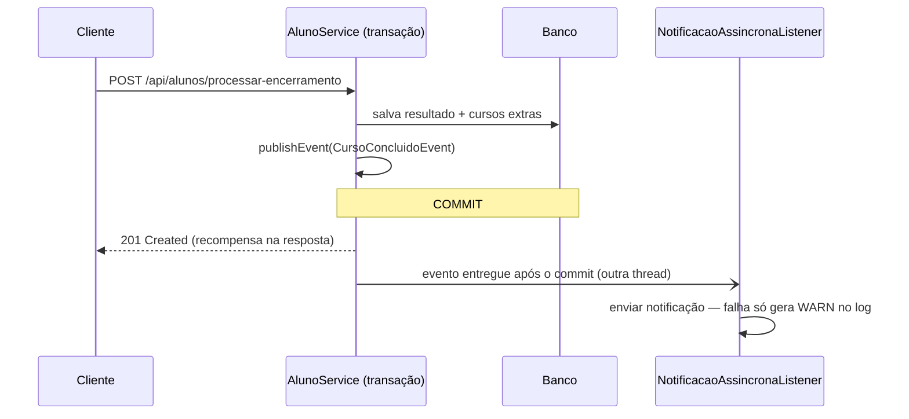

# Arquitetura — B1 Architecture Lab

Documento cumulativo das decisões arquiteturais do case **Educação Continuada Gamificada**.
Cada desafio segue a trilha: **RF → RNF → ASR + RPC → alternativas → ADR → C4 → evidência**.

> Seções dos Desafios 1–3 e 5–6: preencher pelos responsáveis de cada desafio, mantendo este formato.

---

## Matriz cumulativa de ASRs

| Desafio | ASR | Decisão que ele dirige | ADR |
|---|---|---|---|
| D4 | Tolerância a falhas / disponibilidade da conclusão | Notificação fora da transação (pós-commit, assíncrona) | ADR-004 |
| D4 | Desacoplamento (modificabilidade) | Core publica evento; publicador não conhece consumidores | ADR-004 |
| D4 | Consistência (imediata × eventual) | Recompensa síncrona; notificação eventual | ADR-004 |

---

## Desafio 4 — Comunicação e Eventos

**Problema:** ao concluir um curso, registrar a conclusão e calcular a recompensa **sem** que uma falha de notificação impeça a conclusão.

### Rastreabilidade

RF02 / RF05 → RNF (tolerância a falhas, desacoplamento, consistência) → ASR + RPC → alternativas → **ADR-004** → C4 Container + sequência → `CursoConcluidoEventosTest` + prints.

### Requisitos funcionais afetados

- **RF02 — Conquistas:** concluir curso e conceder 3 cursos extras quando a média for superior a 7,0 (`AlunoService.cadastrar` / `concluirOutroCurso`, rota `POST /api/alunos/processar-encerramento`).
- **RF05 — Notificações:** avisar o aluno sobre a conclusão e a recompensa (novo módulo `notificacao`).

### RNF analisados (FURPS+)

Tolerância a falhas, disponibilidade, latência, consistência, desacoplamento, recuperabilidade.

### ASRs escolhidos

| ASR | Por que altera a arquitetura |
|---|---|
| Tolerância a falhas / disponibilidade da conclusão | Exige que a notificação rode **fora** da transação e da thread da conclusão: muda o estilo de comunicação e a fronteira transacional. |
| Desacoplamento | O módulo `aluno` publica um fato e não conhece consumidores: inverte a direção das dependências entre módulos. |
| Consistência (imediata × eventual) | Define o que é síncrono (recompensa na resposta HTTP) e o que é eventual (notificação/analytics). |

Latência e recuperabilidade foram tratadas como consequências, não como ASRs: o volume do case é baixo e não há exigência de reprocessamento.

### Restrições e premissas (RPC)

- Operações essenciais do Core devem concluir mesmo com consumidor externo indisponível.
- Adotar broker tem custo operacional (equipe de 6, esteira Jenkins e `docker-compose` existentes).
- Core permanece em Java/Spring Boot com banco relacional (H2 local, PostgreSQL no compose).

### Imediato × eventual

| Imediato (síncrono, mesma transação) | Eventual (assíncrono, após o commit) |
|---|---|
| Validar a requisição, registrar o resultado, calcular e conceder cursos extras | Notificar o aluno; analytics |

### Alternativas e trade-offs

| | A) REST síncrono para o notificador | B) Eventos de domínio in-process, assíncronos pós-commit | C) Broker (RabbitMQ / Kafka) |
|---|---|---|---|
| Falha do consumidor | Propaga erro e **desfaz a conclusão** | Isolada; conclusão confirmada | Isolada; mensagem fica na fila |
| Acoplamento | Core conhece o endpoint do notificador | Core só publica um fato | Core só publica um fato |
| Custo operacional | Baixo | Nenhum componente novo | Novo componente para operar, monitorar e versionar |
| Durabilidade do evento | n/a | **Não durável** | Durável |
| Quando faz sentido | A resposta do outro lado é necessária agora | Consumidor no mesmo processo, baixo volume | Consumidor em outro processo, retentativa/entrega garantida |

**RabbitMQ × Kafka:** o fluxo é uma fila de tarefas de baixo volume, sem replay nem log retido; RabbitMQ atenderia. Kafka só se justificaria com alto throughput ou reprocessamento histórico.

### ADR-004 — Notificação de conclusão via eventos assíncronos pós-commit

- **Status:** Aceito
- **Contexto:** a conclusão de curso registra o resultado e concede cursos extras; notificação e analytics são secundários e não podem impedir a conclusão. Hoje não existe consumidor fora do processo do Core, e um broker teria custo operacional.
- **ASRs / RPCs:** tolerância a falhas; desacoplamento; consistência imediata apenas para a recompensa; Core em Spring Boot; custo operacional de broker.
- **Alternativas consideradas:** REST síncrono; eventos in-process assíncronos; broker (RabbitMQ/Kafka).
- **Decisão:** o `AlunoService` publica `CursoConcluidoEvent` após registrar o resultado. O módulo `notificacao` consome com `@TransactionalEventListener(phase = AFTER_COMMIT)` + `@Async`, capturando e registrando falhas. A recompensa permanece síncrona. Não adotamos broker nesta etapa.
- **Consequências:**
  - (+) Falha do consumidor não desfaz a conclusão (evidência: `CursoConcluidoEventosTest`).
  - (+) Só notifica o que de fato foi gravado (`AFTER_COMMIT`).
  - (+) Nenhum componente de infraestrutura novo.
  - (−) Evento **não durável**: se a JVM cair entre o commit e o listener, a notificação se perde.
  - (−) Sem retentativa automática.
  - (−) `@TransactionalEventListener` ignora eventos publicados fora de transação; o `AlunoService` precisa continuar `@Transactional`.
  - **Gatilho de revisão:** consumidor em outro processo (ex.: serviço Python, MQTT) ou exigência de entrega garantida → adotar *transactional outbox* + RabbitMQ.

### C4 — Container (nível afetado)

### Sequência do fluxo crítico

### Implementação

| Arquivo | Papel |
|---|---|
| `AC1/src/main/java/org/example/ac1/aluno/application/CursoConcluidoEvent.java` | Evento de domínio |
| `AC1/src/main/java/org/example/ac1/aluno/application/AlunoService.java` | Publica o evento após salvar |
| `AC1/src/main/java/org/example/ac1/config/AsyncConfig.java` | `@EnableAsync` |
| `AC1/src/main/java/org/example/ac1/notificacao/NotificacaoSender.java` | Porta do consumidor |
| `AC1/src/main/java/org/example/ac1/notificacao/LogNotificacaoSender.java` | Consumidor simulado (pode simular indisponibilidade) |
| `AC1/src/main/java/org/example/ac1/notificacao/NotificacaoAssincronaListener.java` | **Decisão**: pós-commit + assíncrono (padrão) |
| `AC1/src/main/java/org/example/ac1/notificacao/NotificacaoSincronaListener.java` | Baseline acoplado, só para contraprova |

Propriedades: `app.notificacao.modo` (`assincrono` padrão | `sincrono`) e `app.notificacao.simular-indisponibilidade` (`false` padrão).

### Evidência

| Hipótese | Teste | Resultado esperado |
|---|---|---|
| Acoplamento síncrono faz a falha do consumidor derrubar a conclusão | `Sincrono.falhaDeNotificacaoDerrubaAConclusaoEFazRollback` | Exceção + nenhum aluno persistido |
| A decisão preserva a conclusão com consumidor fora do ar | `AssincronoComConsumidorIndisponivel.conclusaoPersisteMesmoComConsumidorForaDoAr` | 3 cursos extras + aluno persistido |
| Caminho feliz | `AssincronoComConsumidorDisponivel.*` | Notificação após o commit; curso não concluído não publica evento |

Prints e requisições: [`evidencias/B1-desafio-4/`](../../evidencias/B1-desafio-4/)

### Levado para a PoC da AF

Eventos de domínio pós-commit para efeitos colaterais da conclusão de curso, com o gatilho documentado para outbox + broker.
