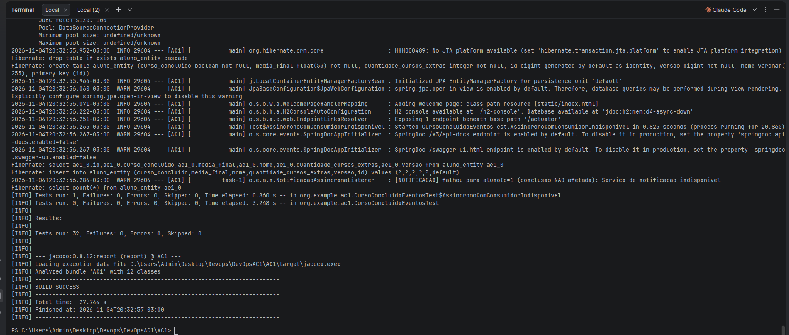
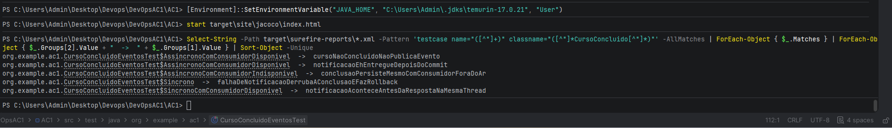
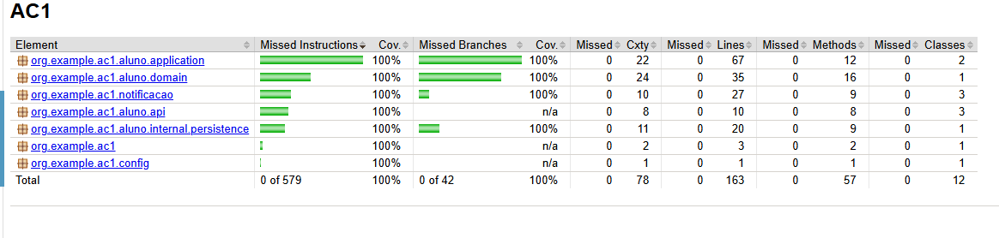
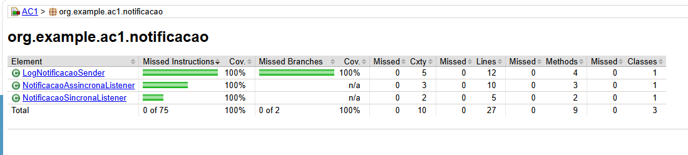
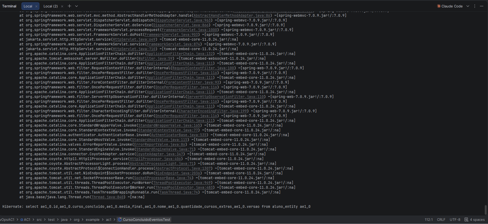
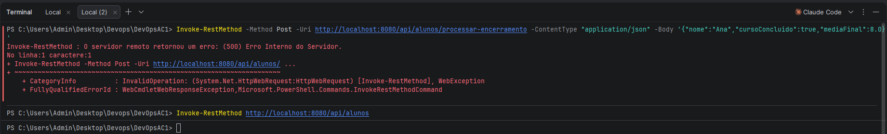
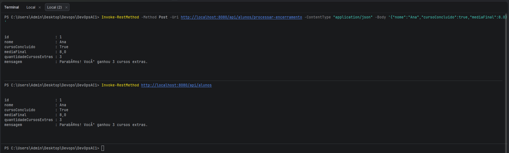
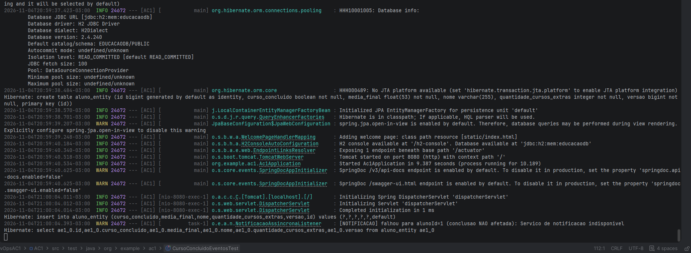

# Evidências — Desafio 4

| # | Evidência | O que prova |
|---|---|---|
| 01 |  | Teste: conclusão gravada e notificação falhando isolada em outra thread (`task-1`) |
| 02 |  | Os 5 testes do Desafio 4 executados |
| 03 |  | Cobertura JaCoCo 100% no projeto |
| 04 |  | Cobertura 100% no módulo `notificacao` |
| 05b |  | Log do modo síncrono: falha da notificação propagada para a requisição |
| 05 |  | **Problema:** modo síncrono — 500 e aluno não gravado (rollback) |
| 06 |  | **Solução:** modo assíncrono — 201 e aluno gravado com 3 cursos extras |
| 07 |  | Requisição em `nio-8080-exec-1`, notificação falha em `task-1` sem afetar a conclusão |

Como reproduzir (dentro de `AC1`):

    .\mvnw.cmd -B package -DskipTests
    java -jar target\AC1-0.0.1-SNAPSHOT.jar --app.notificacao.modo=sincrono --app.notificacao.simular-indisponibilidade=true
    java -jar target\AC1-0.0.1-SNAPSHOT.jar --app.notificacao.modo=assincrono --app.notificacao.simular-indisponibilidade=true

Requisições em `requests.http`.